<div align="center">


<br><br>

<picture>
<source media="(prefers-color-scheme: dark)" srcset="art/branding/agentpal-wordmark-inverse.svg">
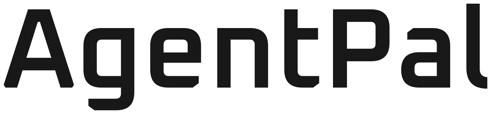
</picture>

<p><strong>Give your agents a place on your desktop.</strong></p>
<p>A visual AI companion workspace for Windows, powered by your existing Claude Code.</p>

<p>
<a href="LICENSE"></a>


</p>

<p><strong>English</strong> · <a href="README.zh-CN.md">简体中文</a></p>
<p><a href="https://github.com/AHuaWinliver/agent-pal/releases">Download for Windows</a> · <a href="#get-started">Get started</a> · <a href="#make-it-yours">Create a companion</a> · <a href="#contribute">Contribute</a></p>

</div>

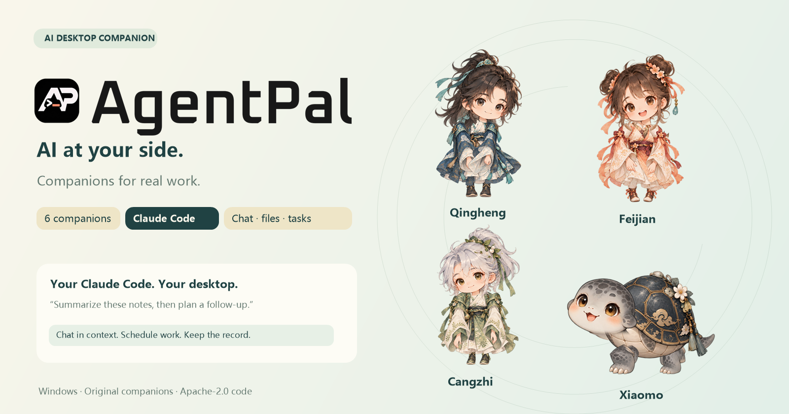

**AgentPal brings desktop companionship and useful agent work together.** Talk with an animated companion, assign a task from its folder, schedule recurring work, set a local reminder, or import a character of your own. Each companion uses the Claude Code executable and settings you choose; progress stays visible in conversations and run records.

**Built for people who already use Claude Code and want a more approachable desktop workflow.** Use one companion for everyday assistance or bind different profiles to specialist companions. You keep the CLI, tools and service configuration you already use.

Six companions are included: **Qingheng, Feijian, Cangzhi, Wukong, Bailong and Xiaomo**. Add your own character packs without reinstalling.

| When you want to… | AgentPal gives you… |
| --- | --- |
| Review a project without typing its path again | A folder-menu task sent to a chosen companion or saved team |
| Use different setups for different work | Per-companion executables, settings and saved task history |
| Turn a recurring request into a routine | Editable weekday schedules, isolated task history and local reminders |
| Make the workflow feel personal | Animated companions, per-companion profiles and importable artwork |

**Current integration: Claude Code.** AgentPal is a desktop interface and orchestration layer; AI execution is provided by your configured CLI and service. Other agent harnesses are a future direction, not a supported integration in this release.

*Screenshots show the application with illustrative tasks and replies. Agent collaboration is still being refined; its current scope is described in the collaboration section.*

## Explore AgentPal

| Start with | What you can do |
| --- | --- |
| [Folder shortcuts](#start-where-your-files-are) | Assign work to a companion or saved team from the current folder |
| [Agent collaboration · experimental](#work-together-see-what-happens) | Explore team batches, dependencies and recorded handoffs |
| [Conversations](#keep-the-conversation-close) | Read structured replies, inspect tool activity and send files |
| [Companion profiles](#a-setup-for-each-pal) | Choose each member's Claude executable and settings |
| [Scheduled work](#make-recurring-work-routine) | Run on chosen weekdays or repeat at an interval |
| [Reminders](#a-reminder-with-personality) | Set local reminders and countdowns with character performances |
| [Desktop interactions](#at-home-on-your-desktop) | Drag, dock, hide, resize and travel with your companion |
| [Custom characters](#make-it-yours) | Import packs, refresh resources and start from three views |

## Get started

1. **Install AgentPal.** Download the Windows installer from [Releases](https://github.com/AHuaWinliver/agent-pal/releases), check its SHA256, and choose your language and installation folder.
2. **Connect Claude Code.** Verify that your CLI works, then open **Default settings** from the companion or tray menu. Set a working directory, Claude executable and optional JSON settings file.
3. **Start a conversation or assign a task.** Open chat from the companion menu, or configure a folder shortcut and send a request from File Explorer.

Try a small first task: **“Review this folder and suggest three next steps. Ask before changing files.”** To try the desktop experience first, choose a companion and set a local reminder; no model connection is required for those interactions.

AgentPal connects to your existing CLI; it does not include Claude Code, a model or credentials. AI access, tool permissions and usage follow your configured service. Desktop interactions and local reminders work independently.

[Installation and first conversation →](docs/GETTING-STARTED.md)

## Start where your files are

Right-click a folder, its background or the desktop and choose **Send Agent Pal task**. Review the current path, enter your request, and confirm. The selected companion opens the **native Claude Code CLI** in that folder with its bound executable and settings.

- **One binding, one click.** A single enabled binding opens its task directly; multiple bindings offer a companion list with thumbnails.
- **Your recurring workflows.** Name your shortcuts, prefill common requests, and bind each shortcut to a companion.
- **A team in the same menu.** Bind a saved Agent team to a shortcut. Each confirmation starts an independent batch with its own agent processes, sessions and run record.
- **A profile for each pal.** Give different companions different executables or settings, with global defaults for everything else.

**1. Choose a companion or team from the menu.**

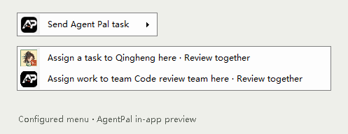

*The image shows AgentPal's real in-app menu preview. Windows 11 main-menu availability depends on shell registration.*

**2. Review the current folder, enter a task, and send.**

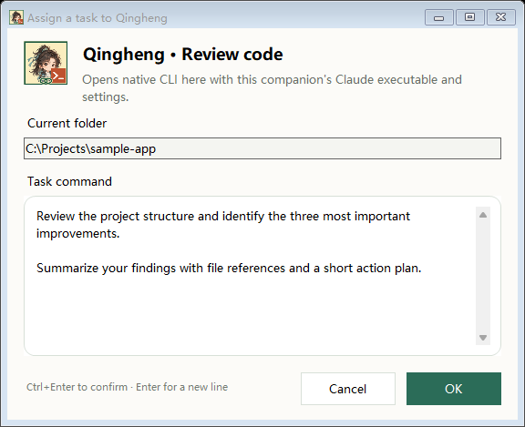

For a team shortcut, the same confirmation starts a new independent batch using the saved roles and dependencies.

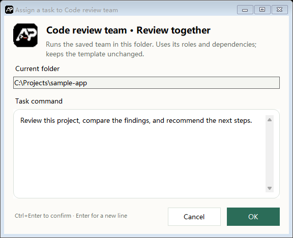

Windows 11 main-menu integration requires the signed shell component and a trusted signing identity. A compatibility menu is also available; on Windows 11 it appears under **Show more options**. See the [native-menu setup](docs/NATIVE-MENUS.md) for this build's requirements.

<details>
<summary>See companion and team bindings</summary>

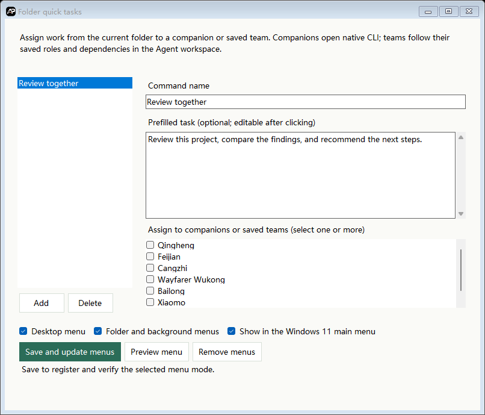

</details>

[Folder shortcuts →](docs/QUICK-TASKS.md) · [Per-companion profiles →](docs/COMPANION-PROFILES.md)

## Work together, see what happens

**Experimental — still being refined.** Team workflows and recovery need further real-world validation. Start with small, supervised tasks and review the run records.

Define roles, assign tasks and express dependencies in the **Agent workspace**. Start with the four-role planner, implementer, reviewer and verifier preset, or build a team around your own workflow.

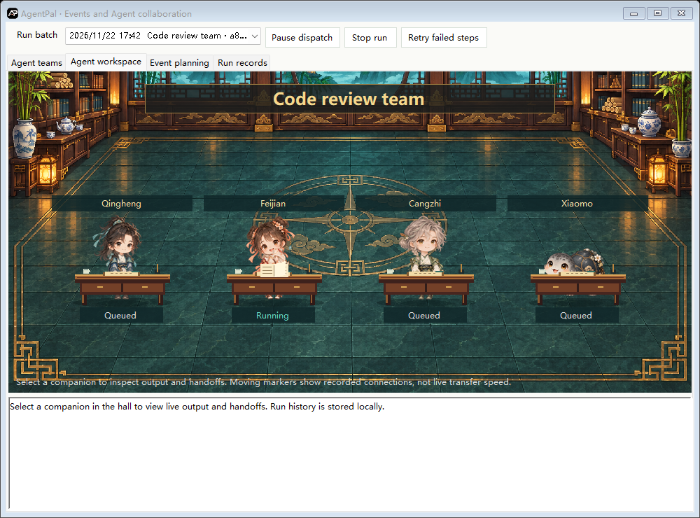

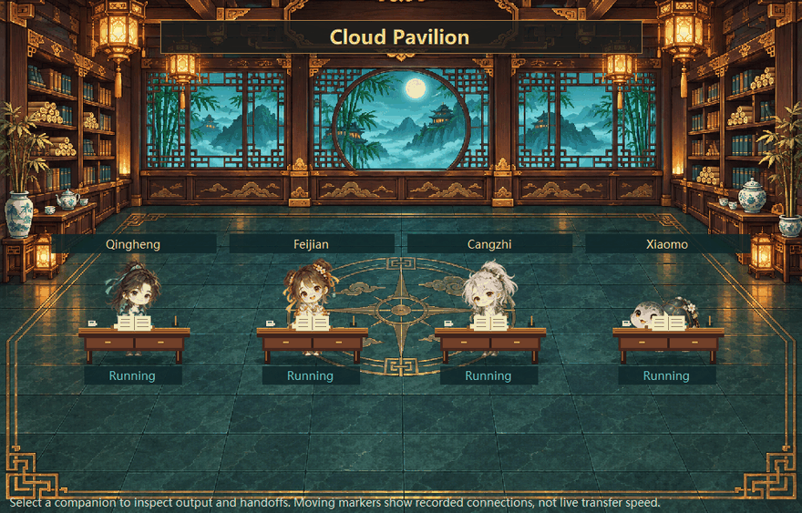

Each submission reuses the saved roles and task graph, with your request as its shared objective. Multiple batches can run at once; choose a **Run batch** to inspect, pause or stop it independently.

Independent tasks can run concurrently with **1–8 worker slots**; dependent tasks wait for their prerequisites. Follow each member's latest reply, inspect tool output, and keep handoff evidence with the run. Failed tasks can pass to another member, with a limit of three total attempts. Pause dispatch when you need to intervene, or set the overall time limit to **0** for unlimited duration.

Working companions walk near their desks and browse reports. Recorded handoffs bring them together. The scene uses the original desktop artwork, resizes with the window, and respects **Reduce motion**.

<details>
<summary>See member status and execution controls</summary>

Every member keeps a portrait, state and latest update in the run view. Select a member to follow its transcript; queued and unassigned members stay visible too.

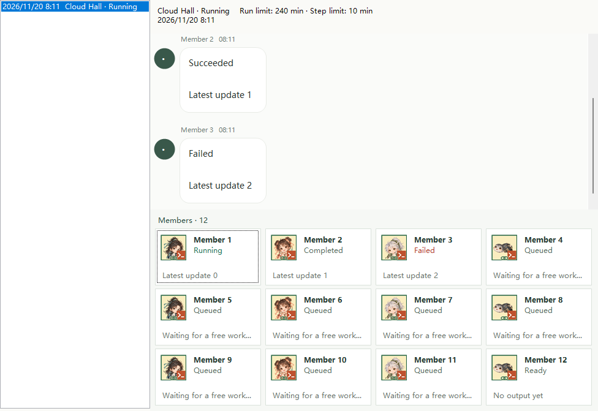

Worker slots, overall and per-step limits, pause controls and recovery settings are managed with the team.


</details>

[Agent workspace guide →](docs/WORKSHOP.md) · [Default roles →](docs/COMPANION-ROLES.md)

## Keep the conversation close

Chat in left/right bubbles beneath your companion, with portraits and structured replies: headings, lists, code blocks and expandable tool activity. Select and copy replies, drop in a file or folder for review, and drag the chat header to move the window and companion together.

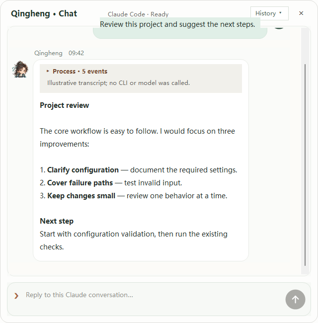

Conversations stay grouped by companion, including proactive messages. Scheduled tasks keep their own history. Docked chat follows the companion's opacity, and the shared tray menu lets you restore a hidden companion or reduce motion. Companion size is in **Default settings**: 75%, 100% and 125%, with a compact 100% default.

Drop files and folders onto the companion, review the selected paths and confirm your request. The **On this day** action is available in the new-conversation footer. Optional proactive messages join the same companion's conversation.

[Chat and interaction guide →](docs/CHAT-UI.md)

## A setup for each pal

Choose global defaults, then override the Claude executable and JSON settings for individual companions. Scheduled tasks use their saved owner; Agent teams use each member's companion profile. Settings open in a separate window and include language, working directory and docked opacity.

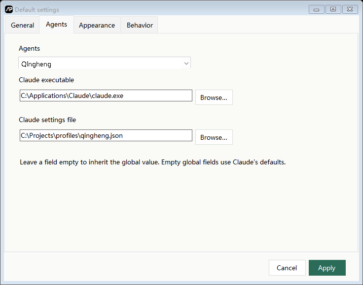

[Profile configuration →](docs/COMPANION-PROFILES.md)

## Make recurring work routine

Edit saved tasks in place without losing run history. Hover over a task’s companion or the creation form’s companion picker to inspect its effective Claude executable and settings-file paths.

Choose an execution companion, working directory and schedule. Run on specific weekdays at a set time, on Monday–Friday or Saturday–Sunday, or repeat every few hours on selected days. Choose whether an active run blocks the next trigger or allows a new run to start.

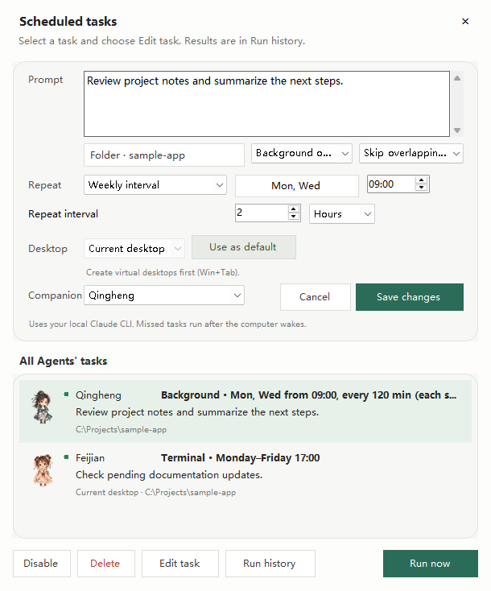

The task window aggregates all companions with owner portraits. Choose terminal or background execution and, where supported, a target virtual desktop. Native Background requires a compatible Claude CLI.

Task output stays in its own run history, separate from ordinary chat. Open a record to inspect its status and saved reply.

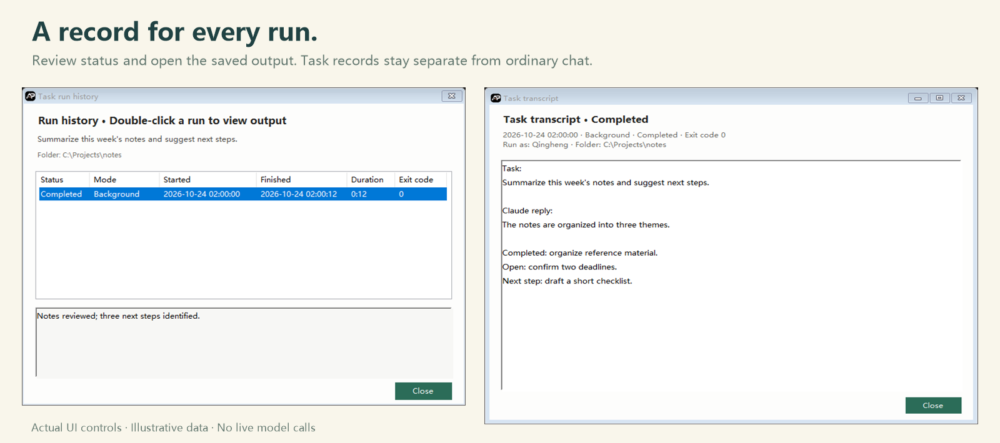

Schedules run while the app is running. AgentPal does not wake a sleeping or powered-off computer.

[Schedules and execution modes →](docs/SCHEDULES.md)

## A reminder with personality

Set a reminder for Monday–Friday, Saturday–Sunday or selected weekdays, or start a quick/custom countdown. Edit an existing reminder in place. Choose a character performance or a simple notification for scheduled reminders; countdowns use a popup. Local reminders do not need a model connection.

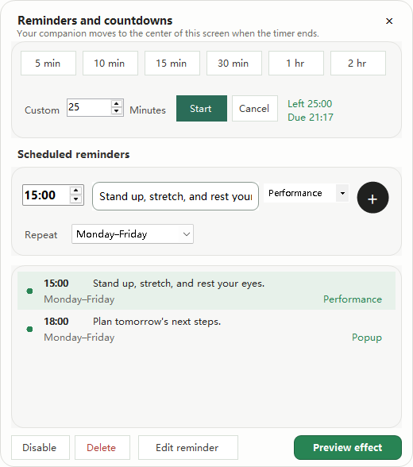

Each companion has its own full-screen performance. Qingheng takes flight on a sword; press **Esc** to dismiss the performance.

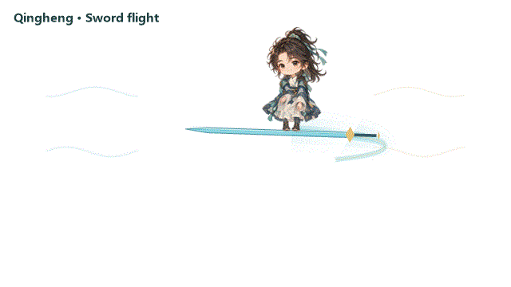

[Reminder and performance guide →](docs/REMINDER-PERFORMANCES.md)

## At home on your desktop

- **Move naturally.** Drag your companion; limb motion follows drag speed. Long roaming routes use its own flying or riding artwork.
- **Stay unobtrusive.** Dock at the screen edge, choose opacity, or hide the companion and restore it from the tray.
- **Keep controls close.** Right-click the companion or click the tray icon for reduced motion, chat, tasks and settings. Change size in Default settings. External Claude-session monitoring is optional and off by default.
- **Keep input steady.** Companion movement pauses while you use settings, task editors and conversation windows.


## Make it yours

**Six pals. One companion spirit.** Each has its own appearance, expressions and actions.

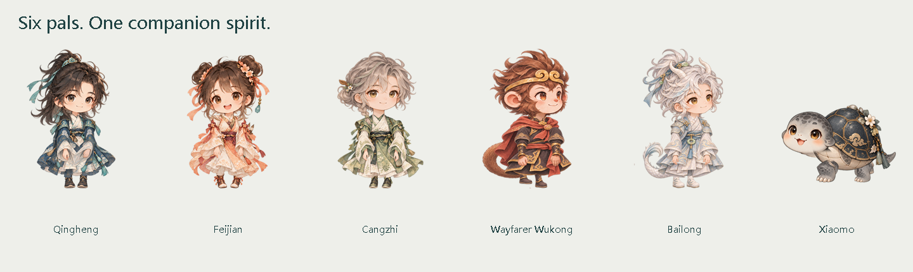

Add a character without reinstalling:

- **Import a pack.** Choose **Companions → Import character pack…**, preview a ZIP, then install and switch. Collections can contain several complete characters.
- **Copy and refresh.** Open the character pack folder, copy in a complete resource folder, then choose **Refresh character packs**.
- **Start with three views.** The image wizard takes front, left-facing and right-facing artwork and creates a local articulated animation draft. Add a description and optional wing or riding artwork. Check the preview carefully: long clothing and hidden limbs may need hand-authored frames.

**Manage companions** keeps built-ins first and imported characters last. Switch companions, delete imported resources without deleting conversations or task settings, and customize each imported companion’s trail colors. Palettes survive resource updates and restarts.

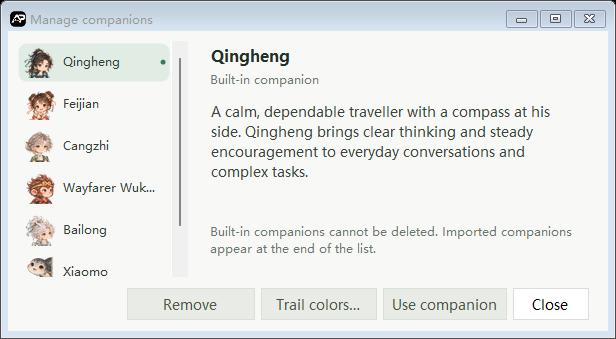

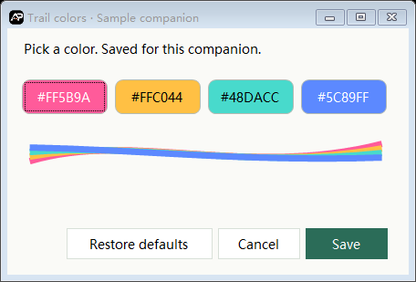

Custom packs contain data and images, not executable plugins. For a finished custom character, the guides cover frame layout, joint anchors, arm/leg coordination, layer order, expressions and full-screen performances.

[Pack format and image wizard →](docs/CHARACTER-PACKS.md) · [Character authoring →](docs/CHARACTER-CUSTOMIZATION.md) · [Character brief template →](docs/templates/CHARACTER-SPEC.md)

## The AgentPal identity

AP brings the name together. The terminal prompt connects it to the work. **The little pal** at the heart of the A gives it a companion's character.

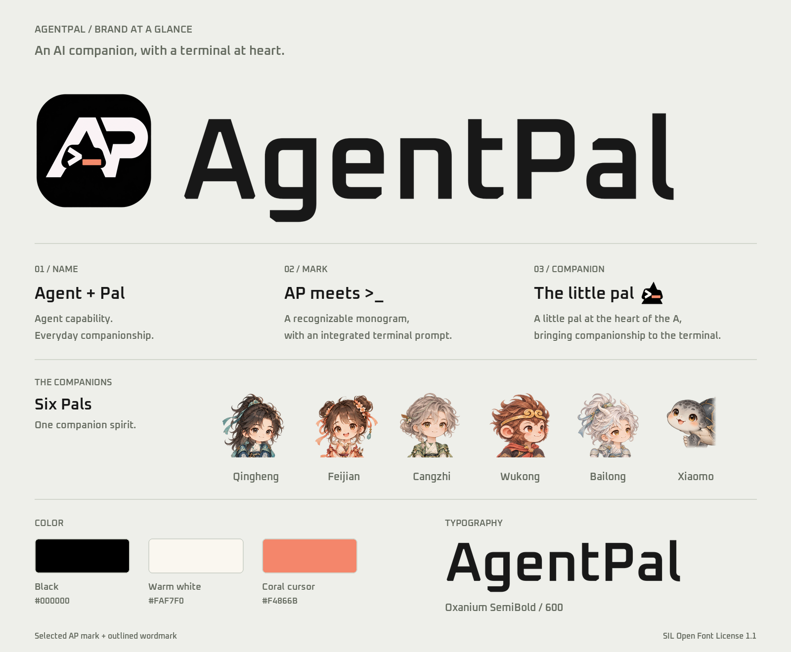

The wordmark uses Oxanium SemiBold, distributed under the SIL Open Font License. Brand files and font notices are in [art/branding](art/branding) and [art/fonts](art/fonts).

## Build and contribute

Windows 10 or 11, PowerShell and the .NET Framework 4.x compiler are required. From the repository root:

```powershell
powershell -NoProfile -ExecutionPolicy Bypass -File .\build.ps1 -SkipInstaller
.\build\payload\agent-pal.exe
```

The build also creates offline animation previews in `build/previews/`. Omit `-SkipInstaller` to create the installer; native shell packaging has [additional signing and tool requirements](docs/NATIVE-MENUS.md#build).

The **Linux port is under development** on the `linux` branch for x86_64 and ARM64. It has a separate compatibility and validation checklist; this README's download and setup instructions describe Windows. [Linux progress →](docs/LINUX.en.md)

<a id="contribute"></a>
Original companions, animation tools, desktop fixes, tests and translations are welcome. Start with an [issue](https://github.com/AHuaWinliver/agent-pal/issues) or follow the [contribution guide](CONTRIBUTING.md). Include screenshots and English/Chinese documentation for major interface changes.

You can contribute without writing application code: test a desktop workflow, improve a translation, share a character pack you have rights to distribute, or help make the authoring guide clearer. For a first code contribution, open an issue with a small, reproducible change and its expected behavior.

**Want to follow the project?** Star AgentPal to keep it close, and use [Releases](https://github.com/AHuaWinliver/agent-pal/releases) for packaged updates. If you tried it, a short [bug report or feature request](https://github.com/AHuaWinliver/agent-pal/issues/new/choose) with your workflow helps shape what comes next.

[Development and testing →](docs/DEVELOPMENT.md) · [Changelog →](CHANGELOG.md) · [Report a bug →](https://github.com/AHuaWinliver/agent-pal/issues)

## Privacy and licensing

<details>
<summary>Where does AgentPal fit in my setup?</summary>

AgentPal provides the desktop companions, request windows, local schedules and team dispatcher. Your selected Claude Code executable runs the AI work with its existing tools and configured service. You can use a cloud or intranet endpoint that already works with that CLI; AgentPal does not supply an offline model. This release supports Claude Code on Windows. Additional harnesses and the separate Linux port need their own implementation and validation.

</details>

Your configured Claude service determines where AI requests are sent. AgentPal stores local settings and run history; installation, upgrade and uninstall leave Claude configuration files unchanged. Native task hooks are loaded only through a private per-run settings overlay. [Privacy and configuration](docs/PRIVACY.md) · [Security reporting](SECURITY.md)

Code: [Apache-2.0](LICENSE). Artwork and brand assets: see [asset licensing](ASSET-LICENSE.md), [art provenance](art/PROVENANCE.md) and the included font notices. AgentPal is an independent project and is not affiliated with Anthropic.
