<div align="center">


<br><br>

<picture>
<source media="(prefers-color-scheme: dark)" srcset="art/branding/agentpal-wordmark-inverse.svg">
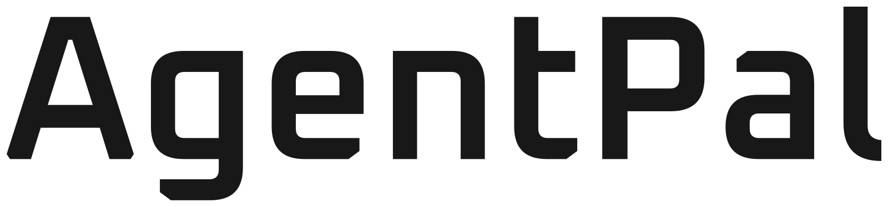
</picture>

<p><strong>让 Agent 成为身边的伙伴。</strong></p>
<p>连接已有 Claude Code 的 Windows 可视化 AI 伙伴工作台。</p>

<p>
<a href="LICENSE"></a>


</p>

<p><a href="README.md">English</a> · <strong>简体中文</strong></p>
<p><a href="https://github.com/AHuaWinliver/agent-pal/releases">下载 Windows 版</a> · <a href="#开始使用">开始使用</a> · <a href="#定制你的伙伴">定制伙伴</a> · <a href="#参与贡献">参与贡献</a></p>

</div>

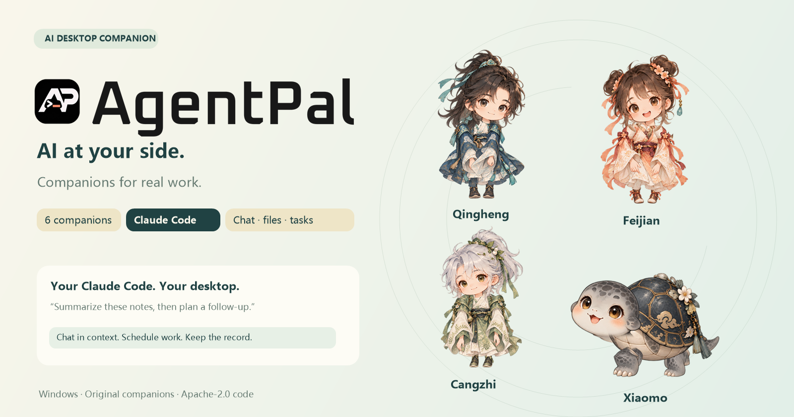

**AgentPal 把桌面陪伴与 Agent 工作流放在一起。** 与动态伙伴对话，从当前文件夹派任务，安排定时执行，设置本地提醒，或导入自己的角色。每位伙伴使用你指定的 Claude Code 程序与配置，过程保留在对话和执行记录中。

**适合已在使用 Claude Code、希望桌面操作更直观的用户。** 可以只用一位伙伴处理日常请求，也可以给不同伙伴绑定专业配置，继续使用你已有的 CLI、工具与服务配置。

内置六位伙伴：**青衡、绯笺、苍芷、行者悟空、小白龙、小墨**。也可以导入自己的角色资源，无需重装。

| 你想做什么 | AgentPal 提供什么 |
| --- | --- |
| 审查一个项目，不再反复输入路径 | 从文件夹右键向伙伴或团队派任务 |
| 给不同工作使用不同配置 | 伙伴独立程序与 settings，以及保存的任务记录 |
| 把重复请求变成固定安排 | 可编辑的星期计划、独立执行记录、本地提醒 |
| 让工作流更有自己的风格 | 动态伙伴、独立配置、可导入的角色素材 |

**当前集成：Claude Code。** AgentPal 提供桌面交互与任务编排，AI 执行由配置的 CLI 和服务完成。其他 Agent harness 是后续方向，本次版本尚未提供对应集成。

*截图中的任务和回复为演示数据。团队协作仍在完善，当前范围见对应章节。*

## 探索 AgentPal

| 从这里开始 | 可以做什么 |
| --- | --- |
| [文件夹快捷任务](#从文件所在的位置开始) | 在当前目录把任务交给伙伴或已保存的团队 |
| [Agent 协作 · 实验性](#一起工作看得见过程) | 体验团队批次、任务依赖与交接记录 |
| [对话交互](#对话就在身边) | 阅读结构化回复、查看工具过程、提交文件 |
| [伙伴配置](#每位伙伴独立配置) | 分别设置 Claude 可执行程序与 settings |
| [定时任务](#把重复工作交给计划) | 指定星期与时间执行，或按间隔重复 |
| [提醒与倒计时](#让提醒也有伙伴的个性) | 本地提醒、倒计时与角色全屏演绎 |
| [桌面互动](#自然融入你的桌面) | 拖动、吸附、隐藏、调整大小与乘坐灵器 |
| [角色定制](#定制你的伙伴) | 导入角色包、刷新资源、从三视图起步 |

## 开始使用

1. **安装 AgentPal。** 在 [Releases](https://github.com/AHuaWinliver/agent-pal/releases) 下载安装包、核对 SHA256，选择界面语言与安装目录。
2. **连接 Claude Code。** 先确认 CLI 能正常使用，再从伙伴或托盘菜单打开**默认设置**，设置工作目录、Claude 可执行程序和可选的 JSON 配置文件。
3. **对话或指派任务。** 从伙伴菜单打开对话；也可以先配置文件夹快捷命令，再从资源管理器提交任务。

首次可以试试：**“检查当前文件夹，给出三个后续建议；修改文件前先询问。”** 如果想先体验桌面效果，直接切换伙伴、设置本地提醒即可，无需连接模型。

AgentPal 连接已有 CLI，不包含 Claude Code、模型或账号凭据。AI 服务、工具权限和用量由你的配置决定。桌面互动与本地提醒可以独立使用。

[安装与首次对话 →](docs/GETTING-STARTED.zh-CN.md)

## 从文件所在的位置开始

右键文件夹、文件夹空白处或桌面，选择**发送 Agent Pal 任务**。确认当前路径、输入请求并提交，对应伙伴便会使用绑定的可执行程序与 settings，在该目录打开**原生 Claude Code CLI**。

- **单个绑定直接进入。** 只有一个启用项时直接打开任务窗口；多个绑定时显示带伙伴缩略图的列表。
- **保存常用工作流。** 自定义快捷命令名称、预填任务内容，并分别绑定伙伴。
- **团队也能直接选择。** 将已保存的 Agent 团队绑定到快捷命令，每次确认都启动独立批次，分别创建 Agent 进程、会话与运行记录。
- **每位伙伴独立配置。** 分别设置 Claude 程序与配置文件，未设置的项目继承全局默认值。

**1. 在菜单中选择伙伴或团队。**

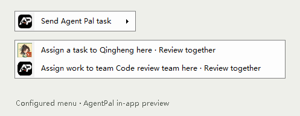

*图片为 AgentPal 程序内的真实菜单预览。Windows 11 主右键菜单是否可用取决于 Shell 注册状态。*

**2. 确认当前文件夹，输入任务并发送。**

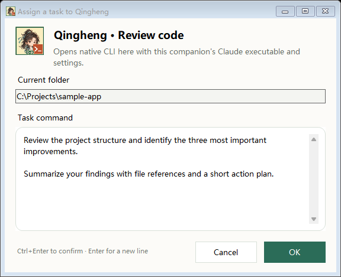

选择团队入口时，确认后会按照已有职责和依赖启动一个新的独立批次。

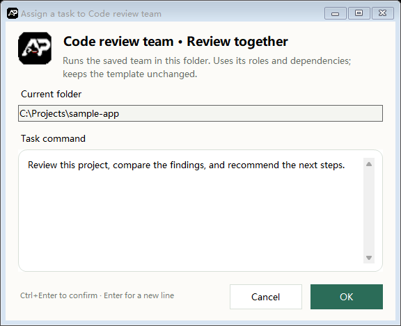

Windows 11 主右键菜单需要签名的 Shell 组件与受信任的签名身份。也可以选择兼容菜单；它在 Windows 11 中位于**显示更多选项**。当前构建的具体要求见[原生菜单设置](docs/NATIVE-MENUS.zh-CN.md)。

<details>
<summary>查看伙伴与团队绑定</summary>

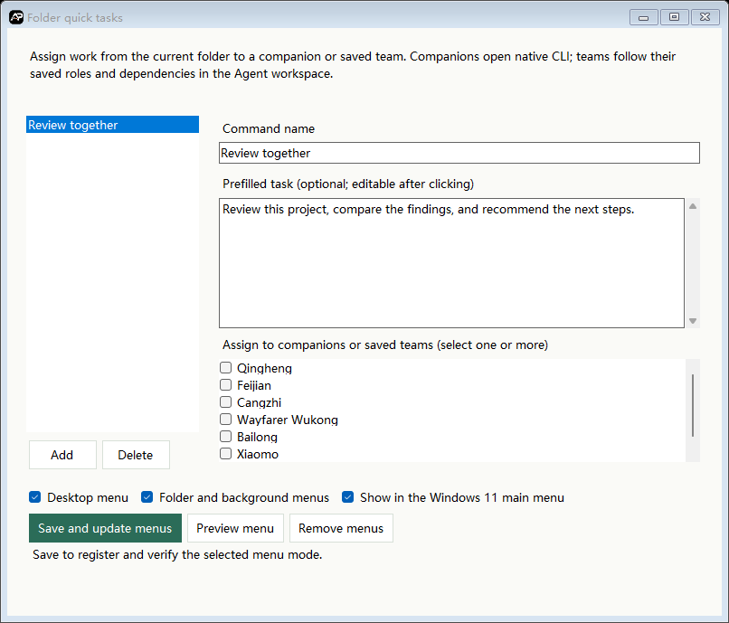

</details>

[文件夹快捷任务 →](docs/QUICK-TASKS.zh-CN.md) · [伙伴配置与任务归属 →](docs/COMPANION-PROFILES.zh-CN.md)

## 一起工作，看得见过程

**实验性功能，仍在完善。** 团队流程与失败恢复还需要更多真实场景验证，建议先从小范围、有人监督的任务开始，并检查执行记录。

在 **Agent 工作空间**中定义角色、分配任务和设置依赖。可以从规划、实施、审查、验证四种职责的预设开始，也可以围绕自己的工作流创建团队。

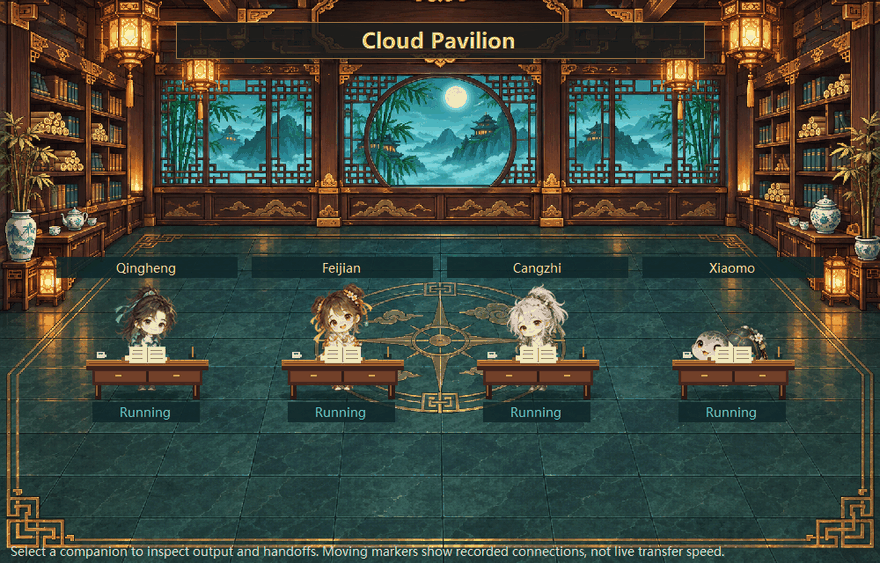

每次提交复用已保存的职责与任务依赖，将本次请求作为共同目标。多个批次可以同时运行，通过**运行批次**选择器分别查看、暂停或停止。

独立任务可通过 **1–8 个执行槽位**并行运行，有依赖的任务等待前置步骤完成。查看每位成员的最新回复、工具输出和交接依据。失败任务可以由其他成员接手，总尝试次数最多三次。需要介入时暂停分发；将整体时限设为 **0**，即可不限整体执行时长。

执行中的伙伴会在桌边走动、翻阅报告，发生交接时走近对方。场景沿用桌面角色的清晰素材，随窗口缩放，并遵循**减少动画**设置。

<details>
<summary>查看成员状态与执行控制</summary>

执行记录为所有成员保留头像、状态和最新进展。点击成员可跟进对应对话，排队中和未分配任务的成员也会显示。

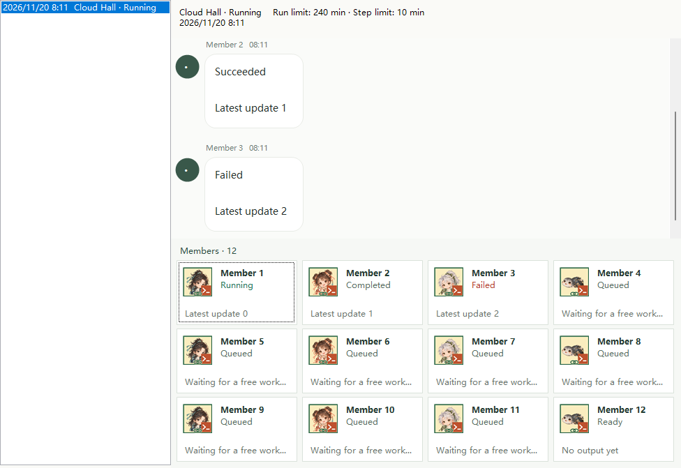

执行槽位、整体与单步时限、暂停分发和失败接手选项在团队中统一管理。

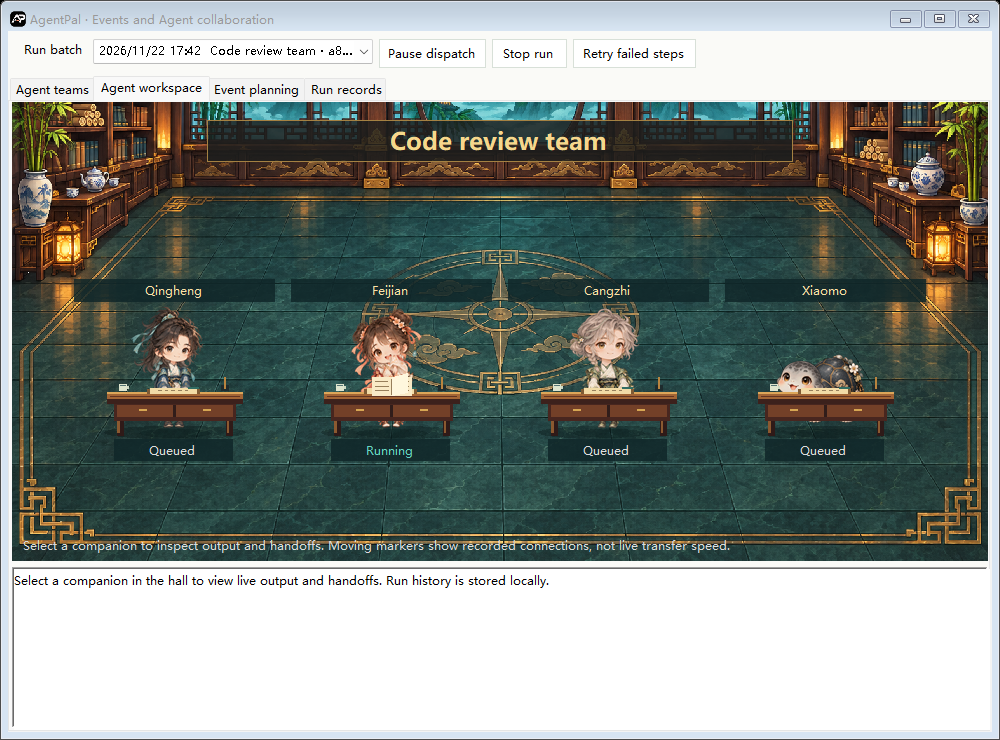

</details>

[Agent 工作空间指南 →](docs/WORKSHOP.zh-CN.md) · [默认角色职责 →](docs/COMPANION-ROLES.zh-CN.md)

## 对话就在身边

在伙伴下方阅读左右气泡对话，配有伙伴头像：标题、列表、代码块，以及可展开的工具过程。支持选中与复制回复，将文件或文件夹拖入并确认任务；拖动对话标题栏时，窗口和伙伴一起移动。

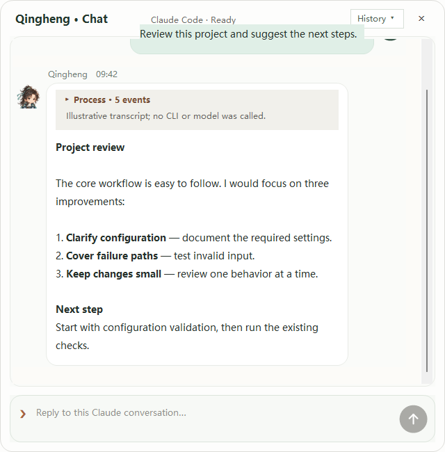

同一伙伴的常规对话与主动消息归集在一起，定时任务单独保存运行记录。吸附时，对话窗口跟随伙伴的透明度；托盘共用菜单可恢复隐藏的伙伴、调整大小和减少动画。

把文件或文件夹拖到伙伴上，检查路径并确认请求后发送。新建对话底部可以使用**历史上的今天**；可选的主动消息也会进入同一伙伴的对话记录。

[对话与交互说明 →](docs/CHAT-UI.zh-CN.md)

## 每位伙伴独立配置

先设置全局默认值，再按伙伴分别覆盖 Claude 可执行程序与 JSON settings。定时任务使用保存的执行者，Agent 团队使用各成员绑定的伙伴配置。独立设置窗口还包含语言、工作目录和吸附透明度。

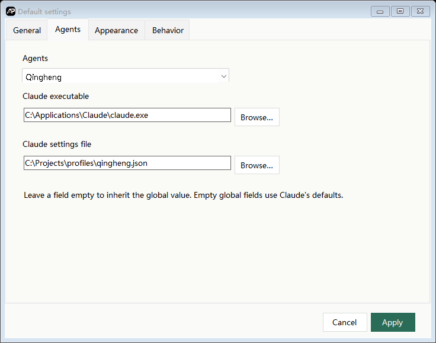

[配置指南 →](docs/COMPANION-PROFILES.zh-CN.md)

## 把重复工作交给计划

选择执行伙伴、工作目录和计划。支持每周指定星期与时间、周一至周五、周六至周日，也可以在指定日期每隔几小时运行。上次尚未结束时，可以跳过本次触发，或开启新任务。

选中任务点击**修改任务**，保存时保留已有运行记录；悬浮任务中的伙伴或创建时的伙伴选项，可查看实际使用的 Claude 程序与配置文件路径。提醒也支持双击或点击**修改提醒**，保存或取消编辑。

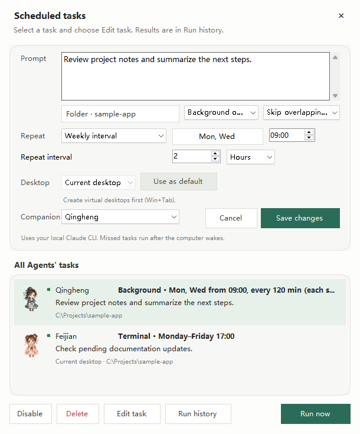

任务窗口汇总所有伙伴的任务并显示所属头像。可选择终端或后台执行，在支持的环境中指定虚拟桌面；原生 Background 模式需要兼容的 Claude CLI。

运行结果独立保存，不进入常规对话。打开记录即可查看状态与保存的回复。

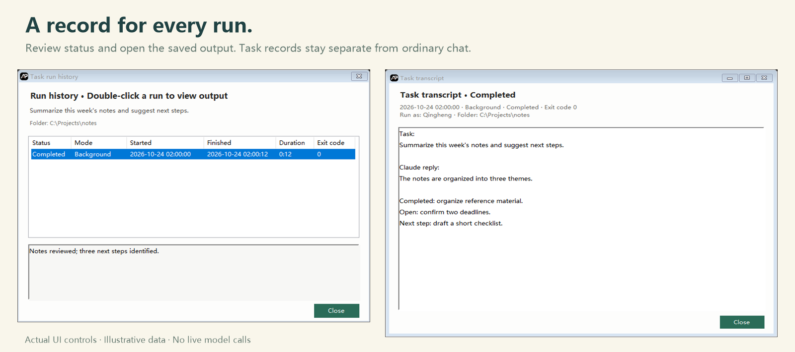

计划依赖应用保持运行，不会唤醒休眠或已关机的电脑。

[执行计划与运行模式 →](docs/SCHEDULES.zh-CN.md)

## 让提醒也有伙伴的个性

为周一至周五、周六至周日或指定星期设置提醒，也可以启动快捷或自定义倒计时。定时提醒可选择角色演绎或简单通知，倒计时采用提示框。本地提醒不需要连接模型。

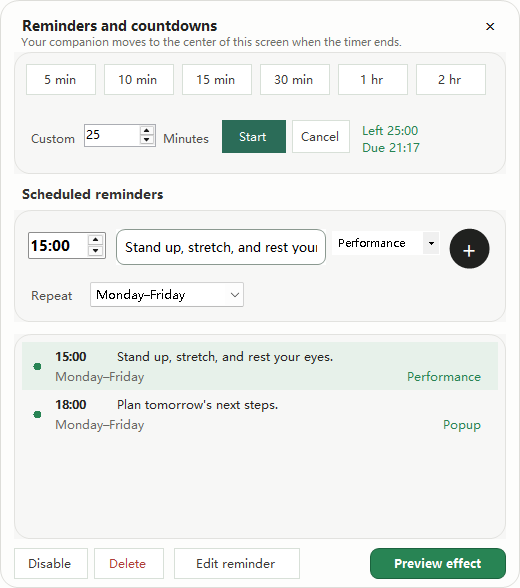

每位伙伴都有自己的全屏演绎。青衡会御剑飞行，按 **Esc** 即可结束演绎。

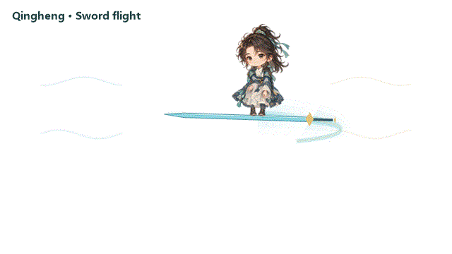

[提醒与演绎指南 →](docs/REMINDER-PERFORMANCES.zh-CN.md)

## 自然融入你的桌面

- **自然移动。** 拖动伙伴时，肢体摆动随速度变化；长距离漫游会使用角色自己的翅膀或乘坐灵器。
- **减少打扰。** 在屏幕边缘吸附、设置透明度，或者隐藏后从托盘恢复。
- **常用操作触手可及。** 右键伙伴或单击托盘图标，可调整大小、减少动画、打开对话、任务与设置。其他 Claude 会话的收集默认关闭，可按需启用。
- **保持输入稳定。** 使用设置、任务编辑和对话窗口时，伙伴暂停主动移动。


## 定制你的伙伴

**六位伙伴，同一种陪伴。** 每位伙伴有自己的外观、表情和动作。

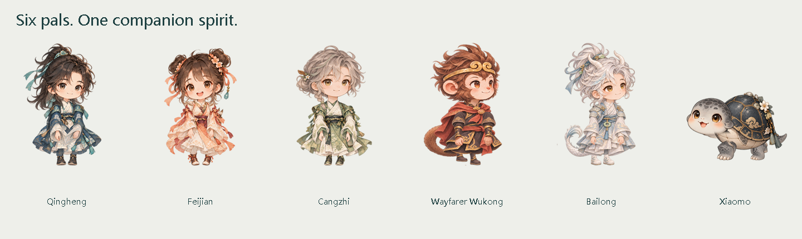

添加角色不需要重新安装：

- **导入角色包。** 选择**伙伴 → 导入角色包…**，预览 ZIP 后安装并切换；合集可以一次包含多个完整角色。
- **复制并刷新。** 打开角色资源目录，复制完整资源文件夹，再点击**刷新角色包**。
- **从三视图起步。** 图片向导使用正面、向左、向右三张素材，在本地创建关节运动草稿。可以补充人物描述和翅膀或乘坐灵器。请先检查预览：长袍和被遮挡的肢体可能需要手工绘制帧。

**伙伴管理**将内置伙伴置前，导入伙伴统一排在最后；支持切换、删除导入资源及自定义轨迹配色，保留对话、任务与配置。轨迹配色在刷新资源和重启后仍然保留。

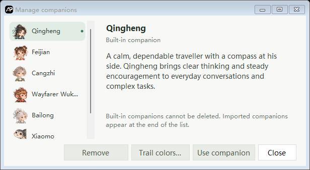

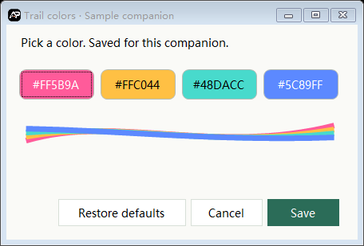

自定义角色包只包含数据与图片，不加载可执行插件。完整制作指南介绍帧目录、关节锚点、手脚协调、前后景顺序、表情与全屏演绎。

[角色包格式与图片向导 →](docs/CHARACTER-PACKS.zh-CN.md) · [角色制作指南 →](docs/CHARACTER-CUSTOMIZATION.zh-CN.md) · [人物设定模板 →](docs/templates/CHARACTER-SPEC.md)

## AgentPal 的品牌设计

AP 连接产品名称，终端提示符连接工作能力；A 中间的小精灵，为技术赋予伙伴的性格。

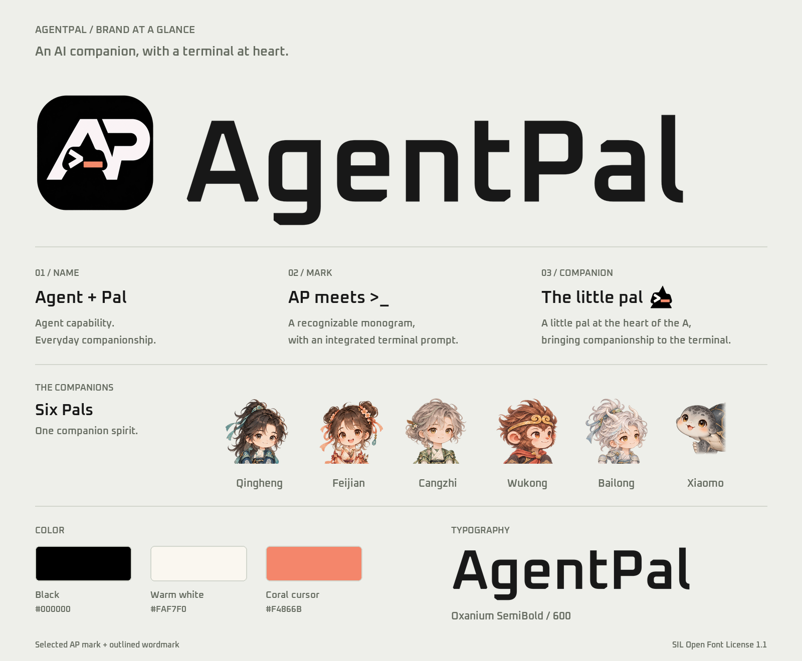

品牌字标采用 Oxanium SemiBold，依据 SIL Open Font License 分发。品牌文件与字体授权说明分别位于 [art/branding](art/branding) 和 [art/fonts](art/fonts)。

## 构建与贡献

需要 Windows 10 或 11、PowerShell，以及系统 .NET Framework 4.x 编译器。在仓库根目录运行：

```powershell
powershell -NoProfile -ExecutionPolicy Bypass -File .\build.ps1 -SkipInstaller
.\build\payload\agent-pal.exe
```

构建同时在 `build/previews/` 生成离线动画预览。去掉 `-SkipInstaller` 可生成安装包；原生右键组件另有[签名和工具要求](docs/NATIVE-MENUS.zh-CN.md)。

**Linux 版仍在开发中**，位于 `linux` 分支，面向 x86_64 与 ARM64，并有独立的兼容性与验证清单。本文的下载与安装步骤面向 Windows。[Linux 进展 →](docs/LINUX.md)

<a id="参与贡献"></a>
欢迎贡献原创伙伴、动画工具、桌面功能修复、测试和翻译。可以先提交 [Issue](https://github.com/AHuaWinliver/agent-pal/issues)，或阅读[贡献指南](CONTRIBUTING.zh-CN.md)。较大的界面改动请附截图及中英文说明。

[开发与测试 →](docs/DEVELOPMENT.zh-CN.md) · [更新记录 →](CHANGELOG.zh-CN.md) · [反馈问题 →](https://github.com/AHuaWinliver/agent-pal/issues)

## 隐私与授权

<details>
<summary>AgentPal 在已有工具链中负责什么？</summary>

AgentPal 提供桌面伙伴、任务窗口、本地计划和团队调度；AI 工作由所选 Claude Code 程序及其已有工具和服务执行。可以使用已能在 CLI 中正常工作的云端或内网服务，AgentPal 不提供离线模型。本次支持 Windows 上的 Claude Code，其他 harness 与独立 Linux 移植需要分别实现和验收。

</details>

AI 请求发往你配置的 Claude 服务。AgentPal 保存本地设置和运行记录，安装、升级与卸载均不改写 Claude 配置；原生任务的联动 Hooks 仅通过独立的会话临时配置加载。[隐私与配置](docs/PRIVACY.zh-CN.md) · [安全问题反馈](SECURITY.zh-CN.md)

代码采用 [Apache-2.0](LICENSE)。角色和品牌素材请查看[资源授权](ASSET-LICENSE.md)、[素材来源](art/PROVENANCE.md)及字体授权说明。AgentPal 为独立项目，与 Anthropic 无隶属关系。


**希望持续关注？** 欢迎 Star AgentPal，方便以后找到它。体验后的问题反馈、翻译改进、可合法分发的角色包和小范围代码修复，都是有价值的贡献。请通过 [Issues](https://github.com/AHuaWinliver/agent-pal/issues) 分享你的使用场景。
