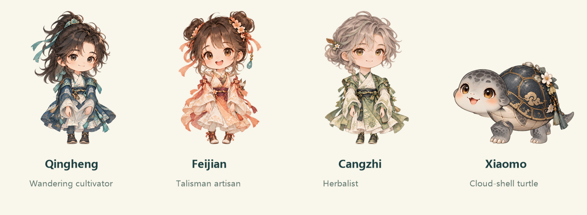
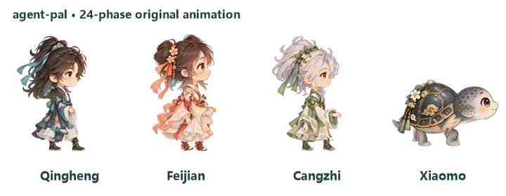

# Creating and animating companions

[简体中文](CHARACTER-CUSTOMIZATION.zh-CN.md)

Keep the approved character design fixed; change joint poses rather than regenerating its identity. Review the images and a complete motion cycle before packaging. Adding a data-only [character pack](CHARACTER-PACKS.md) does not require rebuilding the app. Extending the built-in renderer does.



Use the [character specification](templates/CHARACTER-SPEC.md) to record art sources, proportions, crops, anchors and review results. This is a 2D artwork/animation workflow, not a general 3D modeling system or a ready-made face editor.

## Choose the scope

| Change | Required work | Preserve |
| --- | --- | --- |
| Fix an existing motion | Anchors, paths, layering and focused tests | Identity, clothing, personality, scheduling and window behavior |
| Add an external companion | Complete frames, metadata and checksums | Existing built-in arrays and users' installation |
| Extend a built-in body type | Art, geometry, anchors, states, previews, loaders and tests | Stable IDs and migration behavior |
| Add a performance | Shared timeline, scenery, style mapping and previews | Reminder scheduling and task permissions |

Built-in IDs are `orbit` (Qingheng), `spark` (Feijian), `moss` (Cangzhi) and `pippin` (Xiaomo). Display names can change without changing these compatibility IDs. `PetCharacter.All` remains the build baseline; `Available` includes external packs. The built-in renderer has per-character calibration and count assertions: adding a row to metadata alone is insufficient.

## Authoring workflow

1. Preserve the approved artwork and baseline source in a backup or branch.
2. Record an original design, personality, body type, facing directions, layers, anchors and rights.
3. Approve normal and genuine side-view designs. The face, chest, collar, waist and toes must face consistently; do not squeeze a frontal image into a side view.
4. Create transparent separated parts. Inspect each actual crop rather than assuming a regular grid.
5. Check neck, shoulder, hip and boot connections while standing. Build at least 24 unique walking phases, then interactions and independent expressions.
6. Review left/right travel, stopping, turns, dragging, hover, file interaction and the final-to-first frame transition.
7. Design a personality-specific performance, verify one-monitor placement and reduced-motion/failure behavior.
8. Submit rebuildable artwork, actual prompts/provenance, crops, calibration, tests and previews. Export only after visual review.

AI-generated art is an optional authoring input. Check and save the result before building. The build itself must not call generation services or paid models.

### Suggested art brief

Create transparent layered art for an original chibi companion using its approved design as the sole identity reference. Keep head/body ratio, facial anchors, hair, clothing, patterns, outlines, lighting and palette unchanged. Supply a neutral head, torso, complete sleeves/arms/hands, legs including boots, and mouth/closed-eye references. A quadruped needs a head/neck, shell/body, four limbs and tail. Separate complete parts with transparent margins; record neck, shoulder, hip and sole anchors. No visible skeleton, joint balls, extra limbs, solid background or magenta edges.

Side-view additions must turn the whole design consistently. Expression references change only eyelids or mouth, preserving the skull, ears, hair, neck and original feature positions. A prompt is not a substitute for reviewing actual pixels and connections.

## Inputs and coordinate systems

| Entry | Purpose |
| --- | --- |
| `art/approved-design.png` | Approved identity baseline |
| `art/rigs/regions.json` | Normal/interaction parts and reviewed crop rectangles |
| `art/side-rigs/regions.json` | Side-view walking parts |
| `art/side-torsos/regions.json` | Corrected human side-view torsos |
| `tools/BuildOriginalCharacters.cs` | Import, rigs, mesh deformation, states and expression patches |
| `CompanionMotion.cs` | Neck/shoulder/hip anchors, elbow paths, palm targets and quadruped curves |
| `PetForm` and partials | Playback, movement, input, expressions and lifecycle |
| `ReminderPerformanceTimeline.cs` / `ReminderPerformance.cs` | Shared performance timing and Windows scenery rendering |

The first two region files map IDs to nine `[x,y,width,height]` rectangles in source pixels, not cell numbers or opposite corners. Part 0 is the head; 1 the torso/shell; 2–3 arms/front limbs; 4–5 legs/hind limbs; 6 mouth reference; 7 closed-eye reference; 8 reserved human part or turtle tail. The side-torso file maps each ID to one rectangle, not nine.

Output is 384 × 416 RGBA, rendered at 2× resolution before downsampling. Distinguish source pixels, render coordinates and local normalized UVs. Preserve aspect ratios. All poses need transparent margins, including raised sleeves, ears and tail. Low-alpha import noise (`A < 16`) is cleared, while real antialiased edges remain. This does not repair a colored background or fringe.

## Attachments, layers and facing

- Rotate/scale the head around the actual skin neck root, not the chin, image center or an old collar tip. Normal and walking heads have separate anchors. If the head art includes an old collar, exclude only that clothing region; do not cut the face or repaint a second collar over the hair.
- The turtle's neck narrows/retracts below its jaw into the shell front. Do not shrink its skull or hide a disconnected neck with a forelimb.
- Attach a sleeve using its opaque shoulder centroid. The first 16% stays fixed; the next roughly 18% transitions smoothly into rotation. Shared mesh boundaries prevent seams. Preserve the hand shape and explicitly check palm UVs.
- Hip roots inherit the torso's same-frame transform and remain inside the hem. Stance feet stay in ground coordinates. Connect trousers to the real boot opening; transform boot shaft, heel, toe and sole as one rigid shape.
- Turtle limb roots remain in shell sockets. Deform the lower limb to step; do not translate a whole limb out of the body.
- Gesture arms stay in front. **Side walking uses far arm → torso/head → near arm**, so the body hides the overlapping far sleeve. The turtle's far walking forelimb likewise goes behind its shell. Scenery stays behind the composed companion.
- Human walking art faces right; turtle walking art faces left. Mirror the whole body, expressions and props together when required. Near/far limbs are not anatomical left/right; label the correspondence before checking coordination.

Neck inertia uses a small delayed angle `k × (2.1 sin(t−0.38) + 0.35 sin(2t−0.55))` degrees around the same attachment root. It should read as weight, not head shaking.

### Resting arms and hand orientation

Label anatomical left/right, screen left/right and near/far separately before editing.
For Qingheng's current normal view, the character's anatomical left hand is on
screen right and uses the near-arm texture. An isolated texture's left edge is
not enough to determine which way the hand faces on the complete character.

| Pose | Required result | Reject |
| --- | --- | --- |
| Frontal idle/waiting | Both complete arms hang from their shoulders; palms toward the torso, backs outward | Forearms held at the waist; thumb pointing away from the body |
| Side walking | Nearly straight arms, low small opposing swing; far arm hidden by the torso | Bent raised forearms; both arms drawn above the body |
| Wave/wipe | Active elbow bends to the outside; forearm folds back toward the hand; inactive arm hangs down | Elbow folded across the chest, palm covering the eyes, wiping below the mouth |
| Turn/mirror | Mirror the complete pose and keep anatomical limb identity | Mirroring one sleeve or hand independently to hide a wrong source drawing |
| Gesture exit | Return smoothly to the same hanging rest pose | Abrupt wrist flips, raised hands left at the end, swapping limbs |

Review thumb placement, nails/knuckles, palm creases and wrist rotation **on the
whole character**, with the torso visible. Check both views, both walking
directions, extremes and a slow complete loop. Do not approve an isolated arm
as proof of inward/outward orientation.

Calibrate shoulder sockets on each actual garment, not a template's chest.
Inspect crops for neighboring hair, tassels and warm embroidery: the lowest
skin-colored pixel is not necessarily the palm. Record shoulder, elbow, wrist
and actual palm landmarks. Keep hand/forearm shape and bone lengths; never
stretch fingers to reach a target. See `art/companion-rigs/*/arm-layout.json`,
`art/arm-refinements/orbit/normal-near.json`, and the adjacent exact edit prompt.
Geometry and pixel checks complement visual review; they do not replace it.

Run `tests/companion-motion-test.ps1` and `tests/walking-arm-layers-test.ps1`.
Review generated images before creating a distribution package.

### Proportion approval before wider changes

**All six companion forms were approved on 2026-11-23**: Qingheng, Feijian, Cangzhi, Wayfarer Wukong, Xiaomo and Bailong. Their current identities, proportions, neck/collar joins, shoulder attachments, limb layering and motions form the maintenance baseline. `art/companion-baseline.json` records the approval and digests of all 1,440 frames. Compare later repairs with this baseline; obtain new visual approval for appearance changes.

Review Qingheng first. Compare frontal and both profile views before/after on
the same canvas, with the same head, torso, shoulder sockets and ground line.
Measure shoulder/elbow/wrist/palm landmarks against head and torso height, not
flared hems, tassels or cape tips. Do not resize the whole figure to make its
arms appear shorter.

Shorter arms must still hang naturally, with a gently outward elbow and a palm
slightly toward the torso. Keep connected wrist/hand proportions and cloth
detail; do not stretch fingers or move shoulders to hide the change. The Qingheng baseline was **approved on 2026-11-23**: arm scale `0.88`, symmetric frontal shoulders `(160,217)` / `(224,217)` around `x=192`, an 8 px head/upper-neck lift with the base buried in the collar, and a tailored near sleeve. Normal builds now use it. Calibrate the other humanoids independently; quadrupeds retain their own anatomy.

When an attachment needs moving inward, use the torso centerline, not the
turned head or nose. Review equal shoulder distances/heights and balanced
resting palms. The current Qingheng trial brings its anatomical right shoulder
inward to match the left. Record this anchor change separately from arm scale;
do not mirror a painted sleeve merely to make its silhouette symmetrical.

The lower neck belongs behind the real torso/collar. Keep the upper head, jaw
and hanging hair in front. If head and neck share one texture, split only the
cervical region into two render passes with the same head transform; place the
torso between them. Review frontal/profile movement for gaps or duplicate collars.

Align the neck root with the actual collar opening center in each view. Record
source neck and garment collar anchors separately and move head/neck as one
attachment group; do not stretch the neck sideways or substitute the nose or
hairstyle center for the collar center. Check that the lower neck stays covered
through the whole motion.

If the head/neck sits too low, distinguish the head-neck joint from the lower
neck base buried in the collar. Raise the head and upper neck while keeping
that lower base attached at the collar center with overlap. Record the lift
separately; do not lift the entire attachment free or resize the head to fake it.

Once height is approved, repair only the neck/collar transition. Inspect the
source neck cut edge at enlarged scale. Continue the original painted skin and
shadow into the real collar, burying its end behind the garment; do not use a
flat skin-colored patch or add another collar to cover a seam. Keep the jaw and
side hair intact, and review normal/both walking directions on light and dark.

Inspect the body atlas for a second painted neck stump. Resolve only the old
skin inside the opening, preserving lapel edges, crossed-collar patterns and
shadows. The visible aperture, torso centerline and buried attachment anchor
are distinct landmarks. Review both the complete figure and a neck/collar close-up.

Feather only a narrow local join. First provide continuous opaque skin texture
underneath with overlap, then soften the upper edge. Fading both layers to
transparency creates background lines or white halos. Feather the aperture mask
without blurring the face or flattening real lapel edges. Inspect light/dark
backgrounds and the alpha channel throughout the loop for holes and flicker.

Use the profile painting's own neck skin/shadows for profile joins; a brighter
frontal sample creates a visible stripe. Tune foreground-edge feathering locally
while preserving neck and hair contours. Do not widen the repair into a flat
skin block. Review both directions, extremes and slow loops: opaque pixels alone
do not establish color continuity or a seamless join.

Foreground body layers contain clothing and collars only; the rear head/neck
layer supplies the neck. Inspect normal and profile body atlases independently
for painted neck stumps. Include a body-only layer proof and the composite;
remove old skin inside the aperture while preserving collar edges. Occlusion or
skin-colored overpainting alone is not proof that the duplicate neck was removed.

Balance sleeve volume against the body and the opposite sleeve. For Qingheng,
the anatomical left sleeve is on screen right. Reduce excess fabric flare while
preserving shoulder/wrist anchors, arm length, hand pose and readable ornaments.
Do not squash the palm or crop fingers/tassels to make a sleeve look smaller.

After building the artwork tool, create an isolated comparison in a new folder:

```powershell
.\build\BuildOriginalCharacters.exe --proportions orbit .\build\qingheng-proportions-review .\art 0.88
```

`before`, `candidate` and `proportion-review.json` retain the baseline, trial
frames for further trials; it does not revoke the approved baseline. Complete state/turn/loop/occlusion and seam checks before packaging.

The approved tailored sleeve is now `art/arm-refinements/orbit/normal-near.png`; its candidate and exact prompt remain as provenance. Per-companion data lives in `art/anatomy-calibration.json`: source neck `root`, buried `collar`, visible `opening`, body-UV `aperture`, same-view `skin` sample, `burialY` overlap depth and local `feather` width. `originalNeck` preserves an intact painted neck; `extensionTop` confines texture continuation to its buried end, avoiding a rectangular swatch over the visible neck. Pixel coordinates use the 384×416 canvas; UV coordinates use each cropped part. These are offline renderer parameters, not required user-import settings.

## Natural gait: 24 unique production phases



Use `phase = frame / N`, with the current contract `N = 24`. Eight contact diagrams can help review, but repeating eight images does not create a 24-phase walk. Do not duplicate frame zero at the loop end. Changing the count requires updating generation, loaders, interval calculations, previews and tests together.

The left leg moves forward with the right arm; the right leg with the left arm. Legs differ by half a cycle. Same-side arms and legs are approximately π apart, with slight arm/elbow lag. They retain one shared gait frequency; independent random limb frequencies eventually destroy coordination.

The current relaxed arm swing is `±6 cos(2πphase−0.16)` degrees. Baseline sleeves use only 1–3 degrees of elbow flex; the newer articulated rigs stay nearly straight. Frontal resting palms hang directly below the shoulders. These are calibrated chibi proportions, not universal anatomy. Measure actual palm/foot displacement after mirroring, not just angle signs. Extremes decelerate smoothly before reversing.

Feet use 60% stance / 40% swing. Stance soles stay at render `y=396` while traveling backward relative to the body. Swing uses smoothstep forward motion and a small sinusoidal lift. The knee flexes during swing without inversion or jitter. This is a simplified 2D gait, not a complete biomechanics or perfectly slip-free simulation at every speed.

Human body movement is deliberately small: about 0.75 px vertical, 0.9 px lateral and 0.45° rotation at the reference size. The sole must not inherit the body's bob. Turtle gait alternates diagonal limb pairs with small claw lift and shell movement; never apply the human two-leg rule to it.

Reuse existing velocity-based playback and accumulated drag distance. Slow movement uses lower cadence; faster movement raises it. Stopping returns to standing, and turning preserves phase. Do not rewrite collision, docking or window positioning to repair a limb animation.

## States, expressions and files

| States | Frames each | Review focus |
| --- | --- | --- |
| `idle`, `waiting`, `failed` | 8 | Stable stance, subtle changes, attached arms |
| `running`, `running-left`, `running-right` | 24 | Contralateral gait, soles, facing and margins |
| `waving`, `review` | 24 | Visible palms, gradual entry and exit |
| `jumping`, `punching` | 24 | Compatibility names do not require every character to punch |
| `eating`, `wiping-mouth` | 24 | Correct mouth target; raise → wipe across mouth → lower |

Each character has 240 frames. Four built-ins produce 960 frames, 48 normal/side expression patches and two compatibility images. Changing states or body types requires updating the complete pipeline, not only adding a folder.

`GestureMouth` uses render coordinates; `MouthX/MouthY` uses normalized coordinates. Calibrate both. Directional gestures use a 48-band curve through the shoulder and actual palm/claw; walking sleeves use 24 bands. An enlarged mouth must remain attached and recognizably part of the same face. File eating does not delete originals or bypass the request/directory confirmation flow.

Only local eye/mouth patches come from reference heads. Do not replace the full head. Normal and side patches align separately, with three blink and three mouth transition levels. Independent expression timing must not restart on every gait phase or turn. Keep caches bounded and dispose bitmaps. External packs encode expressions in their complete frames rather than using built-in patch anchors.

## Character-specific fullscreen performance

### Collar and hand acceptance checks

Keep the neck below the clothing layer, centered in the collar. A foreground torso must contain no painted neck: clear the entire neck cap, including its left/right edges, rather than checking only the opening's centroid. Mask the corresponding neck area out of the foreground head pass as well. Rear neck overlap should fill the opening without a horizontal seam, background gap or pale matte on light and dark backgrounds.

All expression variants must use the same registered canvas. Independently tight-cropping neutral/open/blink heads and then fitting them to the same destination changes the head scale. Keep the neutral silhouette, antialiased perimeter and neck pixels fixed while importing expression details; check both the opacity mask and solid neck colors, not only bounding boxes.

Anatomical left/right belongs to the character: a frontal character's left hand is on screen right. In a relaxed stance, the palm turns slightly inward and the back of the hand faces outward; the thumb must agree with that orientation. Do not mirror an entire sleeve to repair the thumb. Preserve cuff registration, upper/lower arm lengths and character-specific shoulder sockets.

When increasing torso volume, preserve the collar anchor, head scale, vertical proportions and hem. Blend the adjustment through the chest, back and waist; moving only one contour creates a thin or detached body. Validate the same correction in idle, failed, waving, mouth-wiping and both walking directions.

See [performance behavior and previews](REMINDER-PERFORMANCES.md).

| Style | Character | Storyboard |
| --- | --- | --- |
| `command` | Qingheng | Summon sword → stand aboard → arc through the scene → land |
| `beam` | Feijian | Raise sleeves → talisman orbit → light hop → settle |
| `warning` | Cangzhi | Raise hand → grow plants → tend them → fade leaves |
| `stone` | Xiaomo | Small hop → landing ink ripples → wave a claw → fade clouds |

Do not reuse a giant fist, screen shatter or strong flash for these characters. Sample elapsed time with `Stopwatch`, not timer ticks. Current timing: entrance ends at 1.12 s, card appears at 5.60 s, effects end at 6.24 s. A 16 ms redraw request does not guarantee 60 fps.

Layout uses the companion's single monitor. Character and prop share their sole pivot, rotation and facing. Measure actual feet for a new body shape; do not hardcode a built-in ratio. Flight uses planted feet, not airborne walking. Trails follow actual path history and taper/fade behind the character.

Windows uses premultiplied per-pixel alpha with a reusable native surface. Keep the card clear, avoid focus capture, preserve Escape/snooze, and release native resources on close or resize. Reduced motion and popup-only modes remain lightweight. If the effect surface fails, show a normal reminder rather than losing it or covering the desktop with black.

## Personality and provenance

`PetCharacter` defines personality, quotes and style; `PetBrain` builds requests. Accurate work, explicit failure reporting and permissions take priority over roleplay. Originality requires an independently designed silhouette, clothing, patterns, name and expression, not a renamed/recolored existing character.

Retain artwork, references and their permissions, actual prompts, tool/date and human revisions in [provenance](../art/PROVENANCE.md). Follow the [artwork license](../ASSET-LICENSE.md). AI assistance is not a guarantee of non-infringement; code's Apache-2.0 license does not grant unrelated artwork rights.

## Review and submission

```powershell
.\build.ps1 -SkipInstaller
.\tools\TestRepository.ps1
.\tests\release-source-test.ps1
.\tests\companion-motion-test.ps1
.\tests\original-assets-test.ps1
.\tests\desktop-visibility-test.ps1
.\tests\reminder-performance-test.ps1
.\tests\smoke-test.ps1
```

Inspect `build/previews/index.html` and `build/previews/performances.html`, including a full loop and frame 23 → 0. Rebuild after changes; do not review a stale browser cache. Numerical tests do not replace visual approval.

- [ ] All states preserve identity, proportions, outline, alpha and safe margins.
- [ ] Neck, shoulders, hips and boots remain connected, with arms/forelimbs outermost.
- [ ] Left/right travel, stops, turns and dragging retain coordinated limbs and grounded feet.
- [ ] Idle stops stepping; hover/gestures transition smoothly; expressions have independent rhythm.
- [ ] File preparation, swallow and mouth wiping are visible without deleting files.
- [ ] The selected character owns its performance on a single monitor at different sizes/scales.
- [ ] Popup, countdown, reduced motion, Escape, snooze and failure fallback remain usable.
- [ ] Long-running switching, scaling and effects do not grow caches or native resources without bounds.
- [ ] No unrelated task, trust, permissions or input changes are bundled into animation fixes.
- [ ] Rebuildable inputs, provenance, crops, calibration, previews and results accompany the PR.

For a new built-in renderer type, also update profile validation, per-ID geometry, directional artwork, frame/expression paths, performance style routing, preview layouts and count assertions. Explain new geometric thresholds rather than disabling tests. The source export uses `tools/PublicFiles.ps1`; include new required tools/tests in its allowlist.

Walking blink/mouth overlays must follow the same calibrated head attachment. Native `profile-expressions/attachment.json` records source translation and collar offsets; runtime and renderer share parent bob/roll, mirroring and neck rotation. Moving only the complete figure leaves overlays behind. `tests/default-companions-test.ps1` verifies 144 expression attachments across both directions.

Review the entire raise–wave–lower sequence, especially as the palm falls below shoulder height. A fixed hand-target IK branch can fold the returning elbow into the torso even when the raised pose looks correct. Lower along a continuous outside joint arc, recording shoulder, elbow and wrist/palm positions through the full cycle. Keep bone lengths fixed and avoid branch snaps or mirrored artwork. Check quadruped forelimb curves independently instead of applying humanoid IK to claws.

A collar-center sample alone cannot prove neck removal: clear the old neck cap, side edges and outline as well. The foreground head exclusion must cover the full neck contour so rectangular feathering cannot repaint its edges over the collar. Record head-UV `headNeckPolygon` separately from body-UV `aperture`; the original neck stays behind the real collar. Inspect pale characters for low-alpha background haze while preserving opaque character pixels.

Three-quarter bodies need their own garment sockets. Do not push another character's shoulders into the chest to copy Qingheng's frontal symmetry. Wukong and Bailong use independent `shoulders` and `walkingShoulders` in `art/anatomy-calibration.json`; crop settings stay in each `arm-layout.json`. Wukong's anatomical left is screen right in the frontal view: a hanging hand shows its back outward and its palm toward the torso. Apply hand refinements below the original bracer only; preserve the sleeve artwork and ornaments.
