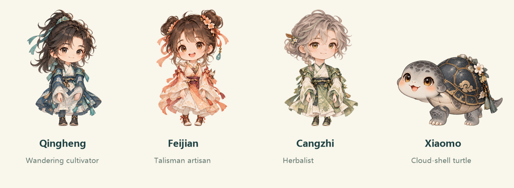
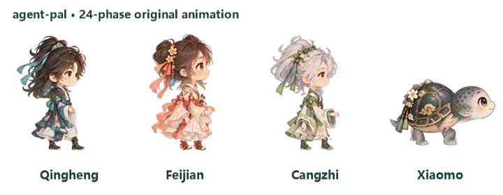

[English](CHARACTER-CUSTOMIZATION.md)

# 人物定制与动画制作规范

## 颈领与手部验收补充

脖子必须放在衣服下层，位于衣领中央。前景身体不能残留画好的脖子：应清理完整颈部顶部及两侧边缘，不能只检查领口中心点；前景头部也应排除重复的颈部区域。后景颈部适当埋入衣领，在明暗背景下都不得出现横线、背景留白或浅灰抠图雾边。

中性、张嘴、眨眼等表情必须共用同一配准画布。各自紧贴轮廓裁切，再缩放到同一个目标框，会改变头部尺寸。导入表情细节时固定中性头部的轮廓、抗锯齿边缘和颈部像素，既检查透明度遮罩，也检查颈部实色，不只看外接框。

左右手以人物自身为准：正面人物的左手位于画面右侧。自然垂臂时手心微向身体、手背朝外，大拇指方向必须相符。修复手掌时不可直接镜像整条袖子；保留袖口配准、上下臂长度和每个角色自己的肩部安装点。

增加身体厚度时，保持领口锚点、头部大小、垂直比例和下摆不变，通过胸、背、腰平滑过渡；不能只移动一条外轮廓。待机、失落、挥手、擦嘴和左右行走均应检查。

本指南对应 AgentPal 当前源码的实际实现，供美术、动画与开发贡献者共同使用。范围包括伙伴创建、分层素材、动作编辑、步态、表情和全屏演绎；不是通用 3D 建模教程，也不代表已经提供可直接导入任意角色的皮肤编辑器。

**核心原则：保留确认后的造型，只改变关节姿态；先预览确认，再导出人物包。** 只有修改程序能力时才需要重新构建安装包。不要以修复动作的名义重新生成角色的头型、五官、服装或比例。模板见 [人物定制规格单](templates/CHARACTER-SPEC.zh-CN.md)，底层说明见 [开发与动画](DEVELOPMENT.zh-CN.md)。

**外置资源包路径**：只添加伙伴时，按 [角色热更新教程](CHARACTER-PACKS.zh-CN.md) 提供完整动作帧、配置和校验清单即可，无需改应用源码或重装。本文的原画/关节规范仍适用；后文涉及四角色、编译和代码扩展的内容特指“基础素材渲染器”，不是外置包或默认伙伴的数量限制。外置包由自身完整帧负责表情和关节，不能直接导入原画图集或骨架来代替动作帧。



## 1. 先选定改动范围

| 目标 | 必须处理 | 不应顺带改变 |
| --- | --- | --- |
| 修复既有人物动作 | 关节锚点、路径、层级、专项测试 | 原画身份、AI 人设、任务调度与窗口交互 |
| 替换现有角色外观 | 正常/侧向素材、裁区、全部锚点、表情与演绎校准；必要时修改名字和人设 | 为换皮直接重命名稳定 ID 或旧设置目录 |
| 添加外置人物 | 成品动作帧、配置和SHA256清单，按热更新教程导出 | 修改内置四角色数组或要求接收方重新编译 |
| 增加编译内置的人物/新渲染体型 | 配置、资源生成、几何分支、演出、预览布局、测试数量和兼容逻辑 | 假设只新增一张 PNG 就会自动适配 |
| 只增加演出 | 共享时间线、场景绘制、样式映射、离线预览和演出测试 | 提醒调度、倒计时、任务权限等无关功能 |

现有稳定 ID 为 `orbit`（青衡）、`spark`（绯笺）、`moss`（苍芷）、`pippin`（小墨）。名称是展示信息，ID 是配置/资源兼容标识；不要因改名就更改 ID。`PetCharacter.Find` 还保留历史别名，修改前要检查迁移影响。

内置素材生成器不是完全数据驱动：`PetCharacter.ValidateProfiles()` 限定内置四角色，渲染器包含人体/灵龟及逐 ID 的校准分支，画廊有四列与四条副标题，素材测试也有四角色列表及 1010 张数量断言。扩展此生成器必须同时处理这些入口，**不能靠删除断言让不完整的修改通过**。运行时的 `PetCharacter.Available` 则合并外置资源包，不受内置四角色数量限制。

## 2. 制作与交付流程

1. 复制或备份原画与相关源码，在独立分支/副本中工作；不要覆盖唯一一份已确认素材。
2. 填写规格单：原创设计、人设、体型、正侧方向、分层、锚点、全屏演出及权利来源。
3. 先确认静态正面/三分之四与侧面造型。侧面应真实转动脸部、胸廓、衣领、腰身与鞋尖，不是把正面压扁。
4. 制作透明分层原画，逐块审核裁区，标出真实连接点，再接入现有渲染器。
5. 先验收站立与头身、肩袖、髋腿、靴筒连接；再制作至少 24 相位行走，最后补全其余状态与独立表情。
6. 审查每位角色的左右行走、停走、转向、拖动、悬停、文件交互；对比原设计，确认没有外观漂移。
7. 为该角色设计独立演出，在同一离线/运行时渲染实现中验证单屏、双屏、减少动态及退出清理。
8. 提交素材、实际提示词/来源、裁区、校准代码、测试结果及预览。图像确认后导出人物包；若改了程序，再进行安装包和源码导出。

构建、安装与素材预览都不需要在线生成图片。AI 绘图可以是素材创作手段，但生成结果必须先审查并保存为本地构建输入；不要让用户构建时调用生成服务或付费模型。

### 美术委托 / AI 辅助绘图说明模板

将下列方括号替换为自己已确认的原创设计信息，实际使用版本随素材保存，不要只保留此通用模板：

> 为原创 Q 版人物［名字、体型、服饰、轮廓特征］制作高分辨率透明分层素材，以［已确认且有权使用的设计图］为造型基线。保持同一头身比、五官位置、头发、服装、纹样、线宽、光照和配色。分别提供中性头部、躯干、两条完整肩袖与手掌、两条含鞋靴的腿、张嘴参考头、闭眼参考头；四足角色改为头颈、壳体、四肢和尾巴。各部件完整、互不接触、四周留透明空隙，明确标记肩根、颈根、髋根及鞋底位置。不要绘出可见骨架或关节圆球，不要拼接其他角色。以独立审阅裁区导入，不要求生成器排出精确九宫格。

侧向补绘约束：

> 以同一角色原分层图为身份基线，只改变指定视角为［朝向］的真实侧向/三分之四侧向。脸、耳朵、衣领、胸廓、腰身、鞋尖朝向一致，不改变原头型、头身比例、服饰和线宽。不要把正面横向压缩伪装成侧面；各部件保留与正常视角对应的连接位置和材质。躯干若需单独修正，只输出对应躯干，不顺带改头或四肢。

表情补绘约束：

> 仅改变眼睑或嘴部局部，保持头部轮廓、耳朵、头发、眼锚点、颈根与原表情位置一致。张嘴应生动但不夸张到占满脸，也不另长出一个嘴。其余区域不重绘；导入后仍需对齐与柔边贴片处理。

共同排除：实色底、洋红边、噪点、模糊、额外手脚/耳朵、部件裁切、衣服变样、比例漂移、粗细不一致描边、外观模仿现有知名角色。生成提示词不能代替逐部件验收；不符合连接条件的图片应先修素材，不能靠拉伸和遮盖硬接。

仓库保留的实际过程可参考 [青衡原图提示词](../art/rigs/orbit.prompt.md)、[侧向补绘提示词](../art/side-rigs/prompts.md) 与 [躯干修正提示词](../art/side-torsos/prompts.md)。新角色应使用自己的原创基线和来源记录，不必照搬这些角色的服饰或参数。

## 3. 源码与素材入口

以下路径均相对于项目根目录。

| 路径 / 符号 | 职责与修改时机 |
| --- | --- |
| [art/approved-design.png](../art/approved-design.png) | 原始确认设计板；修动作时不能换成另一种造型 |
| [art/rigs/regions.json](../art/rigs/regions.json) 与同目录 PNG | 站立/交互的透明部件图及实际像素裁区 |
| [art/side-rigs/regions.json](../art/side-rigs/regions.json) 与同目录 PNG | 侧向行走部件；不能只改头而保留正面身体 |
| [art/side-torsos/regions.json](../art/side-torsos/regions.json) 与同目录 PNG | 三个人体行走时单独修正的躯干；当前灵龟不走此替换分支 |
| [PetCharacter.cs](../src/DesktopTasks/AgentPal/PetCharacter.cs) | ID、名字、Persona、Quotes、提醒样式及归一化嘴部参数 |
| [BuildOriginalCharacters.cs](../tools/BuildOriginalCharacters.cs) | 原画导入、裁区、Rig、靴子、网格、各状态与表情贴片生成 |
| [CompanionMotion.cs](../src/DesktopTasks/AgentPal/CompanionMotion.cs) | 共享颈根、肩口、髋点、肘部、手掌目标与四足曲线 |
| [PetForm.cs](../src/DesktopTasks/AgentPal/PetForm.cs) | 资源加载、位移与播放节奏、方向、输入和状态切换 |
| [PetForm.Expressions.cs](../src/DesktopTasks/AgentPal/PetForm.Expressions.cs) | 运行时局部表情合成；与动作帧共享头部变换 |
| [ReminderPerformance.cs](../src/DesktopTasks/AgentPal/ReminderPerformance.cs) | 全屏演出唯一时间线、角色姿态和场景绘制 |
| [ReminderPerformanceSurface.cs](../src/DesktopTasks/AgentPal/ReminderPerformanceSurface.cs) | 每像素透明画布与原生资源生命周期 |
| [ReminderOverlayForm.cs](../src/DesktopTasks/AgentPal/ReminderOverlayForm.cs) | 演出与提醒卡片、减少动态、退出及降级 |
| [WalkingPreview.js](../tools/WalkingPreview.js) / [BuildReminderPreviews.cs](../tools/BuildReminderPreviews.cs) | 动作浏览与原生演出导出的离线预览 |

### 裁区结构：不是九宫格

`rigs/regions.json` 与 `side-rigs/regions.json` 都是 `角色ID → 9 个矩形数组`，每个矩形为 `[x, y, width, height]`，单位为**对应原图的像素**，并非格子号或右下角坐标。图集不保证等间距、等尺寸；不能盲切。以仓库现有 JSON 为可运行样本，不要把旧人物坐标套在新图片上。

| 部件索引 | 人体 | 当前灵龟 |
| --- | --- | --- |
| 0 | 中性头部 | 中性头部及颈部 |
| 1 | 躯干/衣物 | 龟壳/身体 |
| 2、3 | 两条完整肩袖/手臂；行走分别用于远/近臂 | 近/远前肢 |
| 4、5 | 两条腿，含鞋靴 | 近/远后肢 |
| 6 | 张嘴参考头 | 张嘴参考头 |
| 7 | 闭眼参考头 | 闭眼参考头 |
| 8 | 兼容预留部件，当前人体主渲染不使用 | 尾巴 |

`side-torsos/regions.json` 则是 `角色ID → 单个 [x,y,width,height]`；人体侧向 Rig 的 `Parts[1]` 会被此裁区替换。**不要给两个 JSON 格式写反。**

### 坐标与画质约束

- 输出帧为 **384×416 RGBA PNG**；先在 768×832 画布绘制再缩小，保留原部件比例。窗口缩放与原画布局是两件事，不要通过拉宽角色填满窗口。
- 区分三种坐标：原图裁区像素、384×416 渲染坐标、部件局部 `0..1` UV。`WalkingTorsoNeck` 等 UV 不能直接当作屏幕坐标；飞剑等场景还要经过角色矩形、缩放、镜像与旋转。
- 所有姿态必须留出安全边缘，包括袖口、耳朵、头发、尾巴和抬手；不能只检查站立帧。固定画布内不裁切，不能用缩小单帧角色掩盖越界导致比例跳动。
- 使用真实透明背景，保留半透明抗锯齿；不要先铺洋红底再色键抠除，也不要把白底当透明。导入器只清理 `A<16` 的微弱底噪，不会自动修复实色底或粉色描边。
- 统一明暗、光源、线宽、材质与头身比例；不因奔跑就换成黑暗版，也不逐帧改变描边粗细。至少在浅、深、棋盘三种背景上检查毛边。
- 裁区只包含目标部件，不混入相邻的耳朵、脸、袖子或道具。人体袖子顶部必须有真实不透明肩口，否则 `Rig` 会拒绝导入。

## 4. 连接、方向与图层：必须保留的约束

### 头颈与身体

围绕**实际颈根**旋转和缩放，而非头图中心、下巴或原图衣领尖端。正常与侧向头图分别校准 `NeckAnchor` / `WalkingNeckAnchor` / `WalkingHeadBox`。身体领口与皮肤颈根必须接触，不能仅用附近衣服像素骗过连接检测。

侧向头图若自带旧衣领，只用 `WalkingOldCollar` 排除该局部，保留头发、脸与耳朵轮廓；新衣领属于躯干且在头发之后，不再覆盖重画一圈。不要用蒙版修掉半张脸。灵龟只收窄/回缩下颌以下的颈部，接入壳前缘，不能缩头骨或用前爪盖住断口。

颈部用很小的延迟转动带出惯性，现有角度为 `k × (2.1 sin(t−0.38)+0.35 sin(2t−0.55))` 度，`k` 依人物校准。它不是甩头；必须与父级身体变换共享颈根。

### 肩袖、手掌、髋腿、鞋靴

- 肩口对准袖图顶部不透明区域的重心，不是透明矩形中心。袖子近肩 16% 固定，后续约 18% 平滑过渡，避免整条手臂连根横移。
- 肘部通过曲线弯折，不能把直袖子当摆钟。相邻网格条带共享边界，避免裂缝；不要拉长手掌。近侧掌心需人工核对 UV，不能把肤色绣花或袖口误判为手。
- 髋点必须继承身体同一帧的摆动、旋转和位移，裤腿根位于衣摆内部。支撑脚底使用地面坐标，不继承身体起伏；这样才不会衣摆与腿分离或脚悬空。
- 鞋面、靴筒、脚跟和鞋底做同一个刚性变换，保持原比例；裤腿连接实际靴筒入口并适当重叠。不能分别拉伸鞋底与脚踝。
- 灵龟四肢根部固定在壳体插口，下部曲线迈步，爪子保持完整形状；不能给它套人体膝盖或把整条爪子平移出身体。

### 手臂层级：交互在前，侧走区分远近

**挥手、擦嘴等正面交互保留前景手臂；侧向行走改为远侧手臂 → 身体与头 → 近侧手臂。** 身体覆盖远侧手臂与衣身重叠的区域，不能再把侧走的两条手臂都叠到身体最前面。灵龟侧走的远侧前肢也先于壳体绘制；四足后肢根部仍按壳体连接规则处理。

复用 `DrawWalkingBackgroundArm` 与 `DrawWalkingForegroundArms` 分别绘制侧走的远、近臂；`DrawHumanForegroundArms` / `DrawTurtleForegroundArms` 保留交互动作前景。不能用后补的整块蒙版把近侧手掌一起擦掉。全屏场景放在完整角色位图后方，不重新拆分已合成的肢体层级。

挥手、擦嘴时，画面右侧手臂应在右外侧屈肘，再由前臂向手掌方向折回。新伙伴需在自己的衣身上校准肩点，不能直接沿用几何模板的胸口坐标；手抬起时沿身体外侧走弧线。用 `tests/walking-arm-layers-test.ps1` 验证实际像素遮挡，并检查两种行走方向。

正面待机、等待时，双臂从肩部自然垂下，上臂、前臂和手掌一起下垂；不要把手收在腰前。侧向行走同样保持近乎伸直，只作约 ±6° 的轻微对侧摆动，不使用抬起前臂的走姿。交互动作做完后恢复垂手姿态；原画的肩点与掌心要单独校准，不能靠拉长手指来伸直整臂。

### 手部朝向与整臂验收：本轮修正形成的规则

先标注人物自身左/右手，再标画面左/右、近/远侧；这三套标记不能互相代替。青衡当前正面视角中，**人物自身左手是画面右侧、近侧那只手**。不能因为用户说“左手”就编辑画面左边的袖子。换视角或镜像后需重新核对映射。

| 状态 | 必须满足 | 常见错误 |
| --- | --- | --- |
| 正面待机、等待 | 整条手臂从肩自然垂下；手心朝躯干，手背朝外，拇指位于该姿态应有的身体一侧 | 只放下手掌，前臂仍抬在腰前；把拇指画向身体外侧 |
| 侧向行走 | 上臂、前臂近乎伸直，双臂低位小幅摆动；远臂被身体遮挡、近臂在前 | 屈肘抱手走；两臂都覆盖衣身；手掌随身体上下漂移 |
| 挥手、擦嘴 | 活动侧手肘向身体外侧，前臂再折回手掌；非活动臂保持下垂 | 手肘朝胸内折；手掌遮眼；擦嘴只在腰边摆手 |
| 左右转向 | 整体镜像身体与肢体，并保留同一解剖学身份 | 单独翻袖子或手掌，导致左右手、指向或装饰反转 |
| 手势结束 | 回到相同的垂手基准姿态，首尾连续 | 结束仍举着手；为接循环突然翻腕或换另一条手臂 |

手掌必须放回完整人物检查：同时看躯干所在方向、拇指、指甲/关节与掌纹。孤立手臂图片中“拇指在左/右”不等于人物上的“朝内/外”；手心朝向、拇指位置和腕部旋转应共同合理。静态图、正反侧、两个摆臂极值与完整慢放均需查看。不得用镜像整条袖子来掩盖单个手部朝向错误。

肩点要落在本伙伴实际衣身的肩口，不能沿用模板的胸口坐标。源图裁区要逐块检查相邻头发、金色绣花、流苏是否混入；最低的肤色像素不一定是掌心。需要记录原始裁区、肩点、肘点、腕点和真实掌心 UV。手、腕与前臂保持形状，不得拉长手指、压扁拳头或改变肢体长度来碰到目标。

源码参考：`art/companion-rigs/*/arm-layout.json`、`art/arm-refinements/orbit/normal-near.json`、`tools/BuildOriginalCharacters.Custom.cs`。精确生成提示词与素材同目录保存。几何/像素检查只能证明连接和遮挡等约束，不能替代整个人物的视觉审核；图像与动作确认后再打包。

### 身体比例：先确认单个伙伴，再调整其余伙伴

**六位伙伴已于 2026-11-23 全部确认定稿**：青衡、绯笺、苍芷、行者悟空、小墨、小白龙（Bailong）。当前形象、比例、颈领连接、肩臂安装、肢体遮挡及动作作为后续维护基准，确认记录与 1,440 帧摘要见 `art/companion-baseline.json`。后续修复需与该基准比对；涉及造型变更时重新提供样张确认。

先以青衡做独立比例样张，确认后再处理其他伙伴。样张必须包含同一画布、同一头身与同一脚底基准的正面、左右侧走修订前后对照；不能通过缩小整个人物造成“手臂变短”的假象。

- 标尺使用实际肩、肘、腕与掌心，不把宽袖下摆、流苏或披风末端当作手臂长度；同时记录头高、躯干高和臂长的相对关系。
- 收短上臂、前臂时，肩点保持在原衣身肩口，肘部仍略向身体外侧，手掌只微微向躯干转入。保持自然垂手，避免过度伸直、反折或抬回腰前。
- 安装点调整需以躯干中线为基准：先检查左右肩距中线的距离与高度，再核对下垂掌心的位置。青衡此次正面试稿把人物右肩向内收，左右肩与掌心保持对称；不能用头部偏向或鼻尖代替躯干中线，也不能镜像整条袖子来凑对称。新的安装点需单独记录修订前后坐标；青衡本轮安装点已随整体效果确认。
- 脖子下端位于身体与衣领后方，由衣身原画覆盖颈根。只有颈部区域放在下层，头、下巴和垂发不能整张压到衣服下面。若头颈共用一张原画，分层绘制颈部与上半头部，两次使用完全相同的头部变换；同时检查正面、左右侧走和颈部摆动，避免断颈或出现第二层衣领。
- 颈根还必须对准衣领实际开口的中心，而不只是放在衣领后面。分别记录源图颈根与衣身领口中心，头、颈作为同一附着组对齐；不能只把脖子横向拉伸到领口。正面与侧面独立校准，头部朝向、发型或鼻尖不能代替衣领中心；逐帧确认下端始终被衣领遮住。
- 头颈显得过低时，区分“头颈连接点”与“埋入衣领的颈部下端”：抬高头与上半颈的同时，仍让下端落在领口中心并保留覆盖余量；不能直接把脖子整体提离衣领，也不能缩放头部来伪装高度调整。抬高量单独记录，正侧面共用附着原则并逐帧检查。
- 高度确认后，只修颈领过渡，不反复移动整颗头。放大检查颈部源图的截断线是否露在领口上方；需要延续皮肤时复用原画的肤色与阴影纹理，末端埋入真实衣领，不能画一块平涂肤色或再叠一个假领口遮缝。分层范围只覆盖颈部，保留两侧头发与下巴轮廓，并以浅、深背景检查正面和双向动作。
- 同时检查衣身贴图是否自带另一段颈部肤色截头；它不能与头部纹理的颈根重复叠加。只处理领口内部的旧肤色区域，保留翻领白边、交领纹样和阴影；按真实开口位置接入皮肤，不能把衣身中线或埋入衣服的附着点误当成可见领口中心。给出完整人物和颈领放大图共同审核。
- 接缝只做局部、窄范围的羽化，先在下层提供连续不透明的原画皮肤纹理并留重叠，再柔化上层接合边；不能让上下两层同时淡到透明，否则会露出背景细线或白晕。衣领开口的蒙版边界也需平滑过渡，保留衣领正常的交叠边缘，不对整个头、脸或服装做模糊。逐帧用浅色、深色和透明通道检查连接处无断线、留白和闪缝。
- 侧向颈部优先取侧面原画自身的皮肤与阴影，不直接套用正面偏亮的肤色条带。前景接合边单独调整柔化范围，并保留原有侧颈与发丝轮廓；不能为了盖线把修补区扩成一整块宽颈色块。左右走向、极值帧和慢放循环都要查看，透明度合格不代表色阶和接线已合格。
- 前景身体层只保留衣服和衣领，不得自带另一段脖子；脖子由后方头颈层统一提供。正面和侧面衣身原画必须分别检查，不能只清理正面而遗漏侧面。交付身体单独图层及合成预览，确认领口内旧颈部肤色已移除、衣领边缘未被裁断；不能单靠遮挡或肤色覆盖掩盖重复脖子。
- 左右袖量与身体比例一起审核。青衡人物左臂位于正面画面右侧：若宽袖过大，应收敛袖身和下摆的横向展开，保留肩点、袖口连接、臂长与手掌姿态，不把手掌压窄，不裁断花纹、指尖或流苏来伪装缩袖。允许原设计细节不同，但两侧视觉重量要协调。
- 上下臂与手、衣料按一致的尺度和连接规则处理，不能独立拉长手指、压缩袖口、移动肩部来补偿比例；检查腕部与手掌是否显得过大或过小。
- **2026-11-23 已确认青衡基准**：臂长系数 `0.88`；正面肩点 `(160,217)`、`(224,217)`，以躯干 `x=192` 对称；头与上半颈抬高 8 px，颈根仍埋入领口；近侧袖量收敛。默认生成流程已启用，不再只限预览。其余人形伙伴按相同规则独立校准，小墨保留四足结构。
- 后续其他人形伙伴按核准的相对比例逐人检查，不能机械复制同一组像素坐标。四足伙伴需使用自身身体结构，不套用人体臂长。

资源工具仍支持隔离生成青衡对照：

```powershell
.\build\BuildOriginalCharacters.exe --proportions orbit .\build\qingheng-proportions-review .\art 0.88
```

输出目录必须是新目录。`before` 与 `candidate` 分开保存；该命令用于再次试调，不撤销已确认基准。全部动作、双向转身、循环、遮挡及接缝检查通过后再打包。

青衡已确认的收袖素材已同步为 `art/arm-refinements/orbit/normal-near.png`，原始候选与精确提示词保留作来源记录。逐角色校准位于 `art/anatomy-calibration.json`：`root` 为源颈根，`collar` 为埋入锚点，`opening` 为可见领口；`aperture` 为衣身 UV 去颈蒙版，`skin` 为同视角肤色采样，`burialY` 为下层覆盖深度，`feather` 为局部接合宽度。原画颈部已完整的伙伴以 `originalNeck` 保留原颈，`extensionTop` 仅控制埋入端的纹理延续，不拿整块肤色条带覆盖可见侧颈。所有像素坐标均基于 384×416 画布，UV 基于各自裁区；这些是源码生成参数，不是用户导入角色包必须手填的配置。

### 方向要整体统一

行走基准：人体侧向原画朝右，灵龟侧向朝左，目标方向相反时整体镜像。头、胸廓、膝盖、鞋尖、手臂、表情与演出道具必须共同变换。非行走原图的固有朝向另由 `NativeHeadFacesLeft` 等逻辑处理，不要把所有素材一律翻成同一方向，也不要单独翻头造成头身相反。

“近侧/远侧”和“解剖学左/右”不是同一个概念；镜像后屏幕左右也会互换。验收前应在规格单标明各部件是哪一条肢体，用对侧关系检查，不能只凭屏幕最左的脚认作左脚。

## 5. 自然步态：至少 24 相位



生产动作取 `phase=f/N`、`f=0..N−1`、`N≥24`。8 张接触示意图可用于审查，不是生产帧数；不要把 8 张图简单复制成 24 张，也不要在运行时仍 `%8` 取帧。循环末尾不重复第 0 帧，边界运动应连续。

当前实现具体使用 24 相位，`PetForm.GaitFrameIntervalMs` 也按 24 计算相位停留时间；若提升至 48 等更多帧，必须同步此处及取帧/测试假设，不能只修改生成器的 `FrameCount`。

### 对侧关系与轻微惯性

左腿前摆时右臂前摆、左臂后摆；右腿前摆时反之。左右腿相差半周期，左右臂反向，同侧臂腿接近 π 相位差。可以有轻微提前/滞后，但不允许改成同手同脚或左右腿同步。

当前低位走姿的 `ArmSwing` 为 `±6 cos(2πphase−0.16)` 度，基础袖型肘部只保留 1°–3° 的放松变化；新增分层伙伴的步态骨骼近乎伸直。正面垂手以肩部正下方为掌心目标。这些数值是当前 Q 版比例的校准，不是任意新伙伴的万能参数。腿通过足部路径和隐藏膝部求解，不是直接把这条余弦同时赋给四肢。调参应检查实际手脚的前后位移，而非仅比较角度正负。

手臂摆幅应小于迈腿幅度，肘与腕保留轻微延迟；四肢到极限时自然减速再反向，避免线性角度跳变。不要要求手脚不同步就给四肢独立随机频率——它们仍共享完整步态周期，否则会逐渐失去对侧关系。

### 落脚与身体重量

现有 `Foot` 采用 **60% 支撑期 / 40% 摆动期**：支撑期脚底保持 `y=396` 并相对身体后移，摆动期以 smoothstep 前送、正弦轻抬脚；鞋靴由同一个脚底支点刚性变换。膝盖在摆动时屈曲，支撑时适度伸展，不能反折或高频抖动。当前脚底路径是简化的二维步态，并非完整生物力学仿真；若增加脚跟着地/脚尖蹬地，应连同鞋底接触、膝部与连续性测试一起更新，不能仅把脚图倾斜。

人体身体起伏幅度约 0.75 像素、重心横移约 0.9 像素、轻微旋转约 0.45°（384×416 基准）；这些只产生重量感，不应变成蹦跳。头颈、躯干与双腿都遵循各自父级，不要把全帧上下挪动后又让脚底跟着跳。

灵龟按四足**对角交替**，不是人体左右臂腿规则；保持至少一组支撑、轻抬爪、固定根部及壳体微动。侧走的远侧前肢位于壳体后方；不要把人形“整臂垂下”规则套到四足灵龟上。

### 与真实位移保持一致

复用 `PetForm` 的速度自适应、拖动距离累积和现有播放逻辑；不要为改步态重写碰撞、边缘吸附、路线或窗口坐标。低速低步频、快速适当加快，停下回站立，转向保留连续相位，避免滑行时只播放站姿或静止时持续迈步。更换步幅/帧数后应重新检查脚底后移与窗口前移是否匹配，现有实现不是所有速度下严格无滑移的物理求解器。

## 6. 其他动作与独立表情

| 状态目录 | 当前帧数 | 重点 |
| --- | --- | --- |
| `idle`、`waiting`、`failed` | 各 8 | 稳定站立、小幅变化；失落不应手臂反折或乱穿身体 |
| `running`、`running-left`、`running-right` | 各 24 | 原地检查与双向移动；对侧摆臂、脚底接触、无裁切 |
| `waving`、`review` | 各 24 | 先抬手再变化，手掌可见；观察动作不遮掉整张脸 |
| `jumping`、`punching` | 各 24 | 保留兼容状态名，不代表所有人物都应挥拳或碎屏 |
| `eating`、`wiping-mouth` | 各 24 | 张嘴位置准确，抹嘴为抬手→横擦嘴边→自然放下 |

每人共 240 张动作帧；四角色 960 张，加 48 张表情贴片及 2 张旧资源名兼容图，总计 1010。新增状态/人物时需同步生成器、加载/播放、预览与测试，不能只增加目录。

- `GestureMouth` 是渲染坐标下的真实嘴部目标；`PetCharacter.MouthX/MouthY` 是另一组归一化参数。不能混用。换头后都要检查。
- `GesturePath` 使用肩根、真实掌心/爪心和目标点，定向手势使用 48 段网格；普通行走袖子用 24 段。不要只旋转整张袖图以假装弯肘。
- 招手、抹嘴通过进入/退出包络连接站姿，不突然弹出一只新手；手掌在路径末端保持形状。当前招手/抹嘴节奏约 24×40ms，不以随意加快播放掩盖缺帧。
- 文件交互要能明显看出准备张嘴、吞入、咀嚼与抹嘴，但不能只有嘴无限变大而头型不动，也不能覆盖出两个嘴。视觉“吃掉”**不删除原文件**，文件任务仍需用户确认需求和工作目录。
- 原图 6、7 只提供嘴/眼参考。用局部柔边贴片合成，不整张替换头部；正常与侧向分别输出 `expressions` / `profile-expressions` 的三档闭眼、三档张嘴。
- 贴片按眼锚点对齐，不能改头发、耳朵、轮廓、颈根或衣领。必须检查第一个嘴部贴片是否就在原嘴上，而不是脸中间。
- 行走表情由独立时钟控制，转向、缩放不反复重置眨眼；静止及减少动态时停用行走表情。组合缓存当前最多 72 张，变更时继续保持有界缓存并释放位图。

## 7. 全屏演绎：按人物特色设计

完整运行约束和预览入口见 [全屏演绎说明](REMINDER-PERFORMANCES.zh-CN.md)。当前样式如下，技术样式名不等于可以随意替换人设。

| ID | ReminderStyle | 主题 | 动作逻辑 |
| --- | --- | --- | --- |
| `orbit` | `command` | 御剑飞仙 | 召剑→站稳踏剑→弧线飞行→落地收势 |
| `spark` | `beam` | 灵符报时 | 挥袖→灵符环绕→轻跃→收势 |
| `moss` | `warning` | 草木知时 | 抬手→枝叶生长→照看→叶光散去 |
| `pippin` | `stone` | 墨涟唤醒 | 小跃→落地墨涟→抬爪→云纹散去 |

新增/替换演出先写“前奏—主动作—回落—事项卡片”分镜。道具、运动方式、色彩与角色相符，不要复制同一拳头给所有角色。当前四角色无碎屏、巨大拳头、强闪光；保留 `punching` 和旧资源名仅为兼容，不是恢复旧效果的要求。

### 时间线与父子变换

- 只修改共享的 `ReminderPerformance.Sample/Render` 等实现，离线与运行时用同一时间线；不要另外写一套外观近似的网页演出。
- 用实际经过时间采样（Stopwatch），不累计计时器触发次数。当前入场结束 1.12s、事项卡片约 5.60s 出现、演出约 6.24s 收完；大幅改时长应连同卡片与测试修改。
- 当前约 16ms 请求一次重绘，不保证机器必定达到 60fps；增加计时器频率不等于补齐动作内容。静态姿态变化与连续位移/旋转分开采样，不重复离散帧造成卡顿。
- 在伙伴所属**单个显示器**内布局，不取两屏合并矩形的中心。计算旋转后的角色和道具外接边界，不能只约束角色中心。
- 飞剑与人物共用脚底支点、旋转及翻转。当前青衡约以素材脚底 `395/416` 的高度校准，这不是其他人物的固定比例；换素材必须重新测量。飞行期间站稳，不在剑上继续跑步。
- 发光尾迹取实际走过的位置，靠身处较粗、向后渐细、半透明渐隐；颜色服从角色，透明度有界。不要用瞬间出现的实色三角形或跨屏直线代替路径历史。

### 透明、交互与降级

- 演出画布使用预乘透明 DIB 与每像素 alpha；不把半透明光混到洋红底再抠色。提醒卡片窗口仍有兼容色键路径，不应据此误改所有旧窗口。
- 场景在人物后面，卡片区域留空；画布不抢焦点且点击穿透，不阻止用户操作。人物与光效不能压住关闭、确认、稍后按钮。
- Esc 可跳过/关闭，稍后提醒沿用原服务；窗口关闭、换尺寸和异常路径释放位图、DC 和原生句柄。
- “减少动态”直接展示静止人物与事项；“仅提示框”和倒计时保持轻量流程。透明画布不可用时降级为普通提示，不能让提醒丢失或出现全黑屏。
- 伙伴更换后采用新角色的演出与动作，不保留前一个角色的拳头、衣袖、道具或人设。

## 8. 人设、台词与来源

通过 `PetCharacter` 的 `Persona`、`Quotes` 和 `ReminderStyle` 配置角色表达，并审查 `PetBrain` 的调用路径。说话风格应和确认的原创角色相符，但工作答复的准确性、任务权限与用户需求优先。不要为了入戏隐瞒失败、编造任务已完成或宣称现实超能力；药师类角色不应冒充真实医疗诊断。

原创意味着独立的人物轮廓、服饰组合、纹样、名字和表达，不是影视/小说/游戏人物换色改名。保存原画、参考图授权、实际提示词、工具/日期和人工修改记录，补入 [来源记录](../art/PROVENANCE.md)；授权范围见 [素材许可](../ASSET-LICENSE.md)。AI 辅助创作不构成绝对不侵权担保，不能把没有权利的素材标作 Apache-2.0。

## 9. 预览、测试与提交

在项目根目录运行，建议源码放在短路径（例如 `C:\src\agent-pal`）。修改输入原画/代码后必须重新生成，不能只刷新旧预览。构建会替换已知生成目录 `build/payload`，不要在其中保存唯一一份手工素材。

```powershell
# 生成素材与程序，不制作安装器；不调用 Claude 或图片生成服务
powershell -NoProfile -ExecutionPolicy Bypass -File .\build.ps1 -SkipInstaller

# 结构、素材、动作与演出专项
.\tools\TestRepository.ps1
.\tests\release-source-test.ps1
.\tests\companion-motion-test.ps1
.\tests\original-assets-test.ps1
.\tests\desktop-visibility-test.ps1
.\tests\reminder-performance-test.ps1
.\tests\smoke-test.ps1
```

打开 `build/previews/index.html` 逐帧审查全部状态；`build/previews/performances.html` 暂停、拖动时间、重放和检查减少动态。若需要单独刷新演出预览，运行 `tools/BuildReminderPreviews.ps1`；动作或表情加载脚本更改后要刷新缓存，不能以浏览器旧图作为结论。

### 必须逐项验收

- [ ] 全部角色身份/比例与确认图一致；无黑底、白底、粉边、噪点、变粗描边和多余肢体。
- [ ] 全部 12 状态按实际帧数逐帧无越界；交互手臂在前，侧走远臂在身体后、近臂在前；头颈肩髋靴筒连续。
- [ ] 正面整臂自然下垂，侧走伸直低位摆动；手心、手背、拇指与解剖学左右均在完整人物中确认。
- [ ] 左移、右移、连续移动、减速停止、转向、拖动：对侧手脚、自然屈肘、无滑行站姿/悬空抖动；灵龟对角迈步。
- [ ] 静止不持续迈步；悬停/手势切换平滑，眨眼嘴部不因转向反复重置。
- [ ] 文件拖入的准备吃/吞入/抹嘴可辨识；真实文件不被动画删除。
- [ ] 演出使用当前角色；单屏、第二显示器、小屏与不同缩放下不跨屏、不裁切、不遮卡片。
- [ ] 仅提示框、倒计时、减少动态、Esc、稍后、退出/恢复正常；透明画布失败不丢提醒。
- [ ] 长时间切换、缩放、动作和演出后，位图缓存与图形资源不无限增长。
- [ ] 无任务执行、CLI 信任设置、会话采集、输入或权限等无关改动；测试不调用真实付费模型。
- [ ] 素材、提示词/来源、裁区、校准、预览和测试结果随 PR 提交；不可仅提交生成目录。

自动检测只能覆盖数值、像素和部分行为，不等于审美确认或所有 Windows 环境验证。尤其需真人看一个完整循环，以及第 23→0 帧的接续；截图通过不能代替动画验收。新增体型导致旧像素阈值失效时，说明几何依据后更新测试，而不是关闭检测。

### 扩展内置角色/渲染体型的代码检查清单（外置包不需要）

1. 在 `PetCharacter.All` 加入唯一稳定 ID、至少 5 条台词、人设、嘴部参数与演出样式；更新 `ValidateProfiles` 的预期数量，并保留已有默认角色和历史 ID 迁移。
2. 提供两套 9 部件图与裁区；人体补充 `side-torsos` 输入。选择兼容体型分支，逐项补齐 `CompanionMotion` 中按 ID 的锚点/头部/手势/方向校准；非人体非灵龟需实现自己的求解器，不能落入人体默认分支。
3. 审查生成器中的硬编码姓名、副标题、图集布局、素材数量日志和输出目录。默认角色资源在根 assets，其他角色在 `assets/characters/<id>`；运行时切换与表情路径必须对应。
4. 审查 `PetForm` 及其分部类的资源加载、菜单、表达缓存和角色恢复逻辑；不要让新 ID 偷用原默认角色的表情或嘴部坐标。
5. 在 `ReminderPerformance` 扩展样式支持、标题、姿态与场景，更新预览生成器的角色/样式列表；保留仅提示框、减少动态和失败降级。
6. 更新动作/素材/桌面/演出测试中的角色枚举、数量与新增体型断言；更新 `BuildReadmeMedia` 中展示布局、角色图、人设介绍与来源记录。运行全部受影响测试，并在短路径的干净副本重新构建。

查找遗漏时可搜索 `PetCharacter.All`、`ValidateProfiles`、四个现有 ID、`FrameCount`、`1010`、`ReminderStyle`；不要全局替换字符串，因为历史别名与兼容资源可能需要原样保留。

## 10. 常见问题定位

| 现象 | 优先检查 | 不应采用的“修复” |
| --- | --- | --- |
| 头型/脸每帧变、耳朵肿起 | 是否逐帧替换整张头；局部贴片对齐及裁区 | 再生成一套外观不一致的 24 张全身图 |
| 头身断开或两套领口 | 颈根、父级矩阵、旧领口排除区 | 用手臂遮断口，裁掉脸，放大脖子 |
| 手臂不摆或同手同脚 | 当前状态与取帧数、纹理掌心实际位移、腿臂对应与镜像 | 四肢用同一个角度、随机改变四肢周期 |
| 袖子脱肩或横向裂缝 | 不透明肩口、固定近肩段、共享条带边界 | 整臂平移、把袖口拉长补缝 |
| 髋腿脱离、鞋脚组合怪 | 身体同帧髋点、真实靴筒、统一鞋靴变换 | 独立拉伸鞋底，让脚底继承身体弹跳 |
| 小墨多出肢体/耳朵、颈太粗 | 裁区相邻部件、壳体插口、下颌以下收窄区 | 整头缩小或把前爪压在壳后掩盖问题 |
| 挥手被挡、抹嘴没擦到嘴 | 最后绘制前肢、掌心 UV、GestureMouth、动作包络 | 在手臂后补脸/壳蒙版，仅在腰边摆手 |
| 粉边/实色背景/演出黑屏 | 真 alpha、合成顺序、预乘透明、画布降级 | 用更粗描边盖粉边或改掉全部窗口色键 |
| 低帧率、动作重复、漂移 | 24 个不同姿态、相位连续、真实位移采样、缓存 | 只缩短计时器，复制 8 帧，增加无限位图缓存 |
| 飞行脚剑分离、跨双屏 | 共用脚底支点/变换、当前显示器矩形 | 角色和剑各算一个中心、用虚拟桌面中心 |

图像与动作确认后，按照 [GitHub 发布指南](GITHUB-PUBLISH.zh-CN.md) 构建交付，并用 `tools/ExportOpenSource.ps1` 导出公开源码。该工具按白名单收录 `art`、`docs` 等目录；新增构建工具/测试还要检查 `PublicFiles.ps1` 和 `.gitignore`，防止源码包漏依赖。

行走眨眼与嘴部贴片也必须跟随本次头颈校准。原生资源的 `profile-expressions/attachment.json` 保存源点平移及领口偏移，运行时与生成器使用相同的父级起伏、转向和颈部变换；不能只移动完整人物 PNG 而保留贴片旧坐标。用 `tests/default-companions-test.ps1` 核对双向 144 个表情附着变换。

挥手必须检查完整的“抬起—挥动—放下”，尤其是手掌回落到肩部以下的阶段。不能只验证举手极值：基于手掌目标的同一逆解分支可能让回落的肘部折入躯干。回落应沿外侧连续收臂，记录整周期肩、肘、腕/掌的位置与关节角；臂长保持不变，不在过渡中突然切换弯折分支或翻转原画。四足伙伴单独检查前肢曲线，不能把人形关节求解直接套到爪子上。

领口去颈不能只采样中心一点：旧颈部的弧顶、侧缘和描线都必须清理。前景头部的去颈区域也要覆盖颈部完整轮廓，避免矩形羽化把颈边再次叠到衣领上；源 UV 多边形 `headNeckPolygon` 与衣身 `aperture` 分别记录，保留原画颈部放在衣领后方。浅色角色还需检查低透明度底色，清除背景雾边并保留不透明人物像素。

三分之四视角的衣身，肩点需落在实际袖口/护肩插口；不能为了套用青衡的对称标准，把别人的肩膀一并推到胸口。悟空、小白龙的正面与侧向肩点分别写在 `art/anatomy-calibration.json` 的 `shoulders`、`walkingShoulders`；裁区参数保留在各自 `arm-layout.json`。悟空人物左手对应正面画面右侧，垂手时手背向外、掌心向躯干；手部重绘只覆盖原护腕以下，不能镜像或替换整条袖子的纹样。
