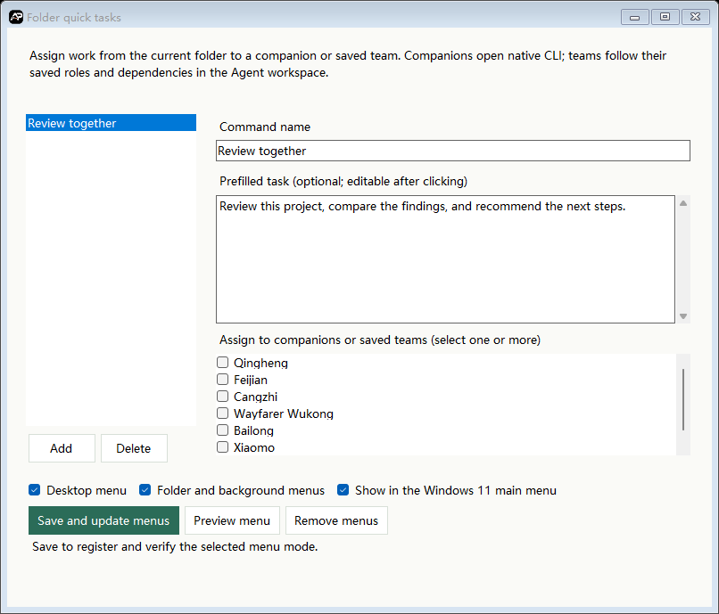
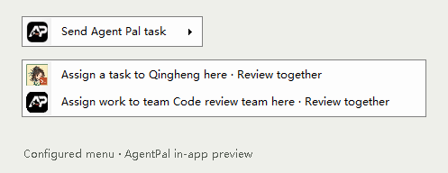
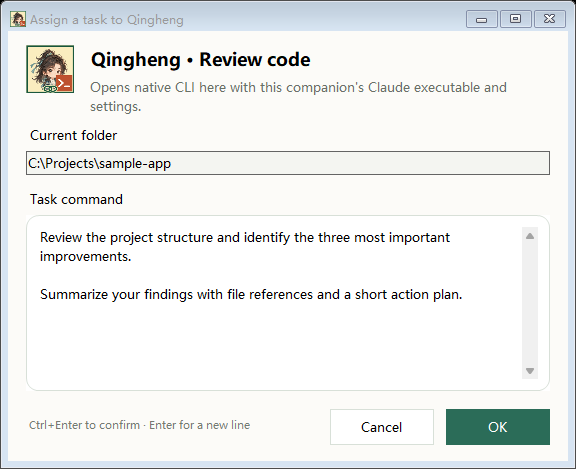
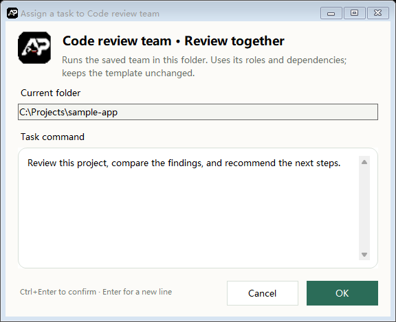
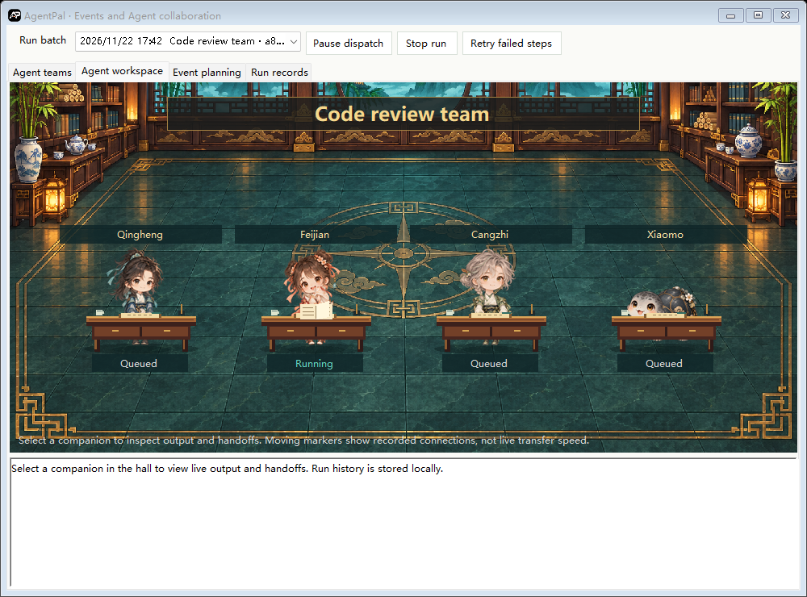

# Assign tasks from a folder

[简体中文](QUICK-TASKS.zh-CN.md)

Send a task to a specific companion without opening the pet first. The native Windows 11 entry is **Send Agent Pal task**, with the fixed product icon. One binding opens directly; multiple bindings open a companion list. The compatibility menu retains direct companion entries.

Companion thumbnails retain their Q-style portrait badges and full-color resolutions. Explorer task editors use the same companion portrait on their taskbar buttons and group by companion, making unfinished requests easier to find. The main application, tray and native menu root keep the fixed AP product icon.

Task editors run as independent windows. Their Shell taskbar group has its own icon resource, title and relaunch command; reopening from the taskbar retains the last folder used by that command/companion binding. Long Unicode folder names are saved in local context data rather than placed in the length-limited Shell command.

## Set up the menu

1. Open **Default settings → General → Manage folder quick tasks…**.
2. Add a command, give it a name and optionally prefill a task. Leaving the task empty creates a reusable assignment entry.
3. Select one or more companions. Each selected companion gets its own direct menu item; there is no second executor menu.
4. Choose Desktop menu, Folder and background menus, or both. Click **Save and update menus**.

Use **Preview menu** to check companion thumbnails and direct labels before updating Windows.

For the Windows 11 main menu, select **Show in the Windows 11 main menu** in a build with the signed shell component. Registration checks the actual native title, icon and state. The preview's test certificate requires explicit system approval; production signing follows Windows deployment policy. [Native setup and troubleshooting](NATIVE-MENUS.md)

The separately selectable compatibility mode registers classic entries under **Show more options** on Windows 11 and requires no administrator account. **Remove menus** removes agent-pal's entries while retaining saved command definitions.

## Assign a task

Right-click a folder, an empty area inside it, or the desktop. Choose the companion's entry. In the small task window, check **Current folder**, enter or edit the command, and click **OK**. Cancel leaves the task unsubmitted.

The selected companion's saved Claude executable and effective settings file are resolved at launch. Empty overrides inherit the global values. The folder you clicked becomes the actual CLI working directory; it does not fall back to the pet's default folder. Desktop entries use the current user's desktop directory, including a redirected desktop.

The new PowerShell window contains Claude Code's native interactive interface. Permissions, trust prompts, follow-up input and slash commands remain under Claude Code's control. Each confirmation creates an independent session and does not change the visible pet or another conversation.

The full user task is written to a UTF-8 request file in the local state directory's `quick-task-requests` folder. A fixed initial instruction directs Claude to that file. This preserves multiline text, quotes and shell metacharacters across both native executables and npm `.cmd` wrappers. Task text is not interpolated into shell code or registry command strings.

Menu definitions live in `quick-commands.json`; thumbnails live in `shell-icons`. Compatibility entries use the current user's `Software\Classes`; native binding slots use `Software\agent-pal\ShellCommands`. The signed identity package supplies the native COM registration. The uninstaller removes entries belonging to its own executable.

This integration is Windows-specific. It does not register Linux file-manager actions.

Validation: `tests/quick-task-test.ps1` uses isolated registry keys, real PowerShell launches and fake `.exe` / `.cmd` CLI programs. It does not contact a model or modify the real Explorer menus.

Implementation references: [Microsoft: extending shortcut menus](https://learn.microsoft.com/en-us/windows/win32/shell/context) and [the merged per-user classes registry](https://learn.microsoft.com/en-us/windows/win32/sysinfo/hkey-classes-root-key).

## Run a saved Agent team

1. In the Agent workspace, create and save a team with its members, roles, tasks and dependencies.
2. In folder quick tasks, select **Agent team · <name>** alongside any individual companions. Each binding remains a direct menu target; one binding opens directly and several appear in a flyout.
3. Right-click the target folder, select the team, enter a shared objective (up to 4000 characters), and confirm.

The app copies the saved team for this run. Your request replaces its shared objective; every member uses the current folder. Roles, task text, dependencies, execution modes, concurrency and time limits stay in place. The saved template is unchanged. Each member uses its own existing Claude executable/settings profile.

Every confirmation starts a new batch, even while another batch is running. Each batch owns independent schedulers, CLI processes, session markers, output and history. Reusing a companion profile does not resume or share its other live conversations. Choose **Run batch** to inspect, pause or stop a specific batch. Editing a template affects future submissions, not existing snapshots.

Coordination follows the saved task graph; this feature does not invent a team or rewrite its task plan from your prompt. Dependencies and write-conflict checks apply within each batch. Separate batches can use the same directory concurrently: use separate folders or worktrees when changes need filesystem isolation.

The independent task editor stays responsive while waiting for the desktop process to accept the request. Expired requests and removed bindings are rejected. If startup confirmation times out, check run history before retrying. Temporary handoff files live under `team-quick-requests`; the editor removes its pending request and acknowledgement after completion. A crash can leave files there; expired requests are never executed.

Tests: `tests/quick-team-task-test.ps1` exercises real local request/acknowledgement files, independent execution batches, dependency gating, Unicode paths, template preservation, team selection and responsive submission with fake agents. It never calls a model.
