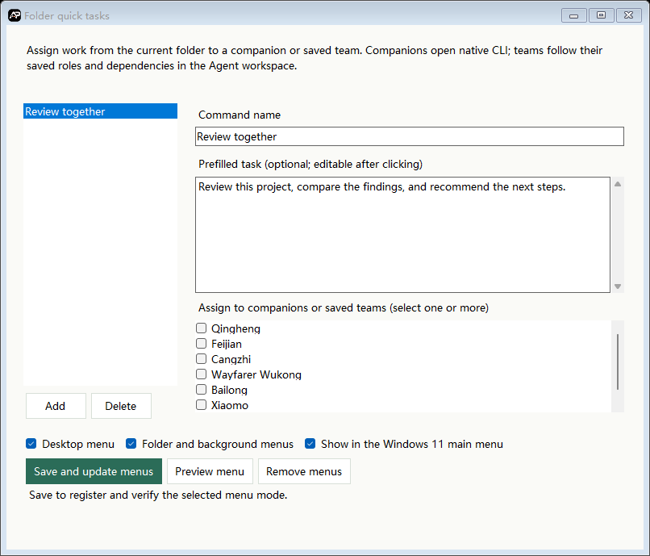
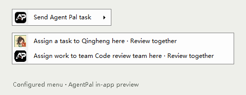
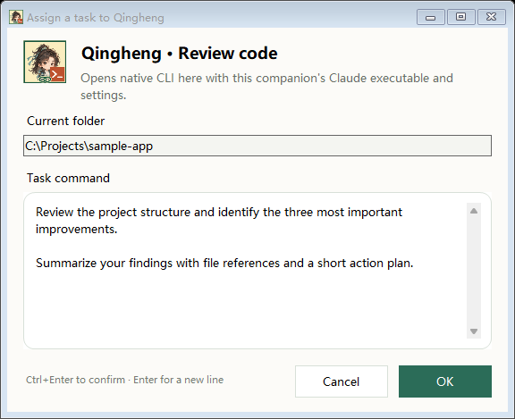
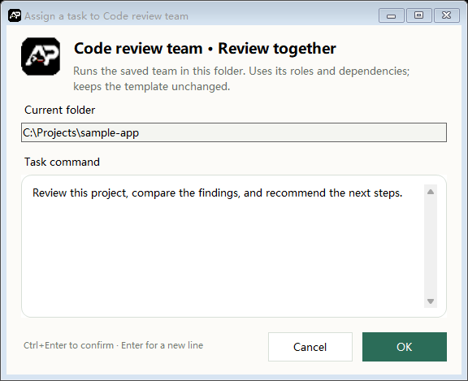
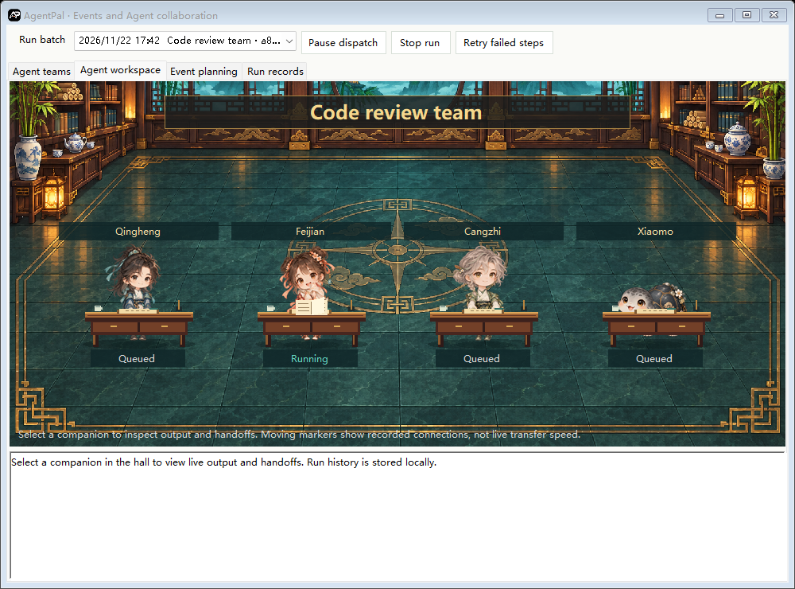

# 在当前文件夹给伙伴指派任务

[English](QUICK-TASKS.md)

桌面、文件夹或文件夹空白处的 Windows 11 原生右键菜单显示 **发送Agent Pal任务**，使用固定 AP 软件图标。一个绑定时直接打开；多个绑定时展开角色任务列表。兼容模式保留直接显示的角色入口。

任务子项保留角色 Q 版头像，多尺寸全彩编码适配不同显示缩放。右键指派任务弹窗在任务栏显示相同的伙伴头像，按角色分组，方便找回正在输入的窗口。主程序、托盘及原生菜单主入口保持固定 AP 软件图标。

任务输入以独立窗口运行，同时为 Windows Shell 指定头像资源、标题和重开命令。由任务栏重新打开时，沿用该命令与伙伴绑定最近使用的工作目录；长中文路径保存到本地上下文文件，不直接塞进长度受限的 Shell 命令。

## 配置入口

1. 打开 **默认设置 → 常规 → 管理右键快捷任务…**。
2. 新增命令并填写名称。预填任务可留空，点击右键项目后再输入；也可预填常用需求。
3. 勾选一位或多位伙伴。每个绑定伙伴都会形成一个独立、带缩略图的右键项目。
4. 选择桌面、文件夹与空白处等菜单位置，点击 **保存并更新右键菜单**。

可先点击 **预览菜单** 检查缩略图和文字，再更新 Windows。

使用包含已签名 shell 组件的版本时，勾选 **直接显示在 Windows 11 主菜单**。程序会核对原生标题、图标和启用状态后才报告成功；试用签名证书需要明确的系统授权。[主菜单设置与排错](NATIVE-MENUS.zh-CN.md)

兼容模式位于 Windows 11 的“显示更多选项”，不需要管理员权限。点击 **移除右键菜单** 移除本程序入口并保留命令定义。

## 执行任务

在目标文件夹、空白处或桌面右键，直接点击伙伴对应的项目。小窗口会显示 **当前文件夹**；输入或修改任务后点击 **确定** 才启动，取消不会提交。

每次启动都会读取所选伙伴绑定的 Claude 程序和实际生效的 settings，空的角色配置沿用全局设置。右键位置对应的目录就是 CLI 的实际工作目录，不退回伙伴默认路径。桌面入口使用当前用户实际的桌面目录，兼容桌面重定向。

新开的 PowerShell 窗口内使用 Claude Code 原生交互界面，可继续输入、使用斜杠命令或完成权限确认。每次确定创建独立会话，不切换桌面伙伴、不打断已有对话，也不自动放宽 CLI 权限。

原始任务保存为本机状态目录 `quick-task-requests` 下的 UTF-8 文件，再用固定启动提示让 Claude 读取。这样中文、多行、引号和 shell 特殊符号不会变成额外命令，也兼容 npm 的 `.cmd` 入口。

配置保存于 `quick-commands.json`，缩略图位于 `shell-icons`。菜单只注册在当前用户范围，移除时校验所有权，不修改其他软件的项目；卸载程序仅清理指向本安装的菜单。

此功能面向 Windows，不会注册 Linux 文件管理器菜单。回归测试：`tests/quick-task-test.ps1`，使用隔离注册表、真实 PowerShell 和假的 Claude 程序，不调用模型、不改真实右键菜单。

## 交给已保存的 Agent 团队

1. 在 Agent 工作空间创建并保存团队，设置成员、职责、任务和依赖。
2. 打开右键快捷任务设置，勾选**协作团队 · 团队名**，也可以同时绑定单个伙伴。每个绑定都是直接执行入口；只有一个时直接打开，多个时才展开。
3. 右键目标文件夹，选择团队，输入本次共同目标（最多 4000 字）并确认。

程序为本次执行复制一份已保存团队：请求替换共同目标，所有成员使用当前文件夹。职责、任务内容、依赖、执行方式、并发和时限保持原样，原团队模板不变。每位成员继续使用自己已有的 Claude 可执行程序与 settings 配置。

每次确认都创建新批次，不会因为已有批次运行而拦截。各批次拥有独立调度器、CLI 进程、会话标记、输出和记录；复用同一伙伴配置，不代表恢复或共享它的其他实时对话。通过**运行批次**选择器分别查看、暂停或停止。修改模板仅影响之后提交的批次，不改变正在运行的快照。

协作依照已保存的任务图，不会仅凭请求自动组队或重写分工。依赖和写入冲突检查在各批次内部生效；不同批次可以同时使用同一目录。需要文件隔离时，请分别使用目录或 worktree。

独立任务窗口等待主程序接收请求时仍可正常重绘。过期请求与已移除绑定会被拒绝；未收到启动确认时，请先查看运行记录再决定是否重试。临时交接文件位于 `team-quick-requests`，编辑窗口结束后清理自己的待处理文件和回执。崩溃可能留下文件，但过期请求不会执行。

测试：`tests/quick-team-task-test.ps1` 使用真实的本地请求与回执文件，以及假的 Agent，验证独立批次、依赖门控、中文路径、模板保留、团队选择及提交时界面响应；不调用模型。
