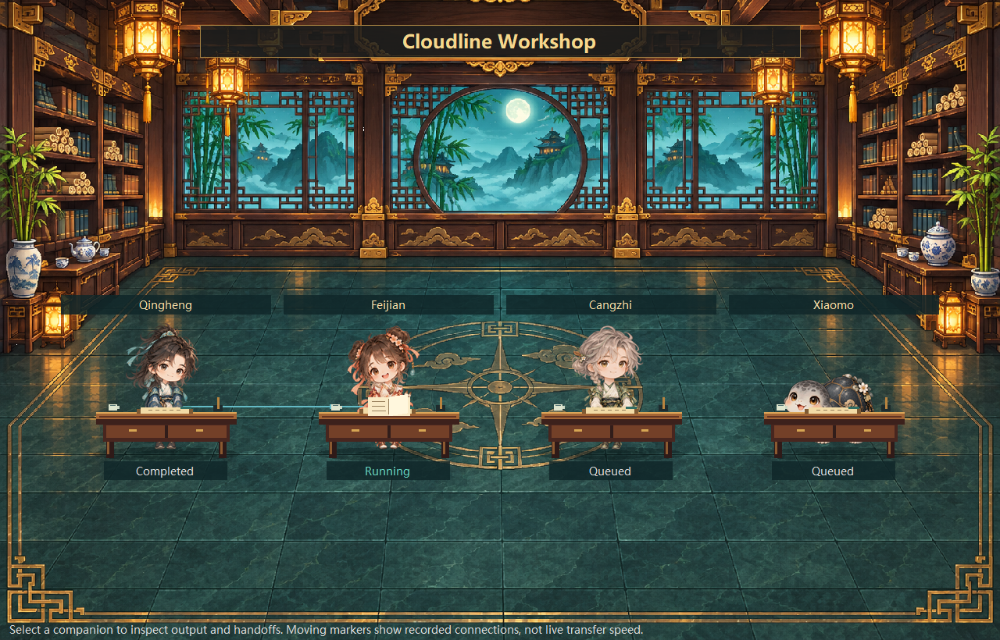
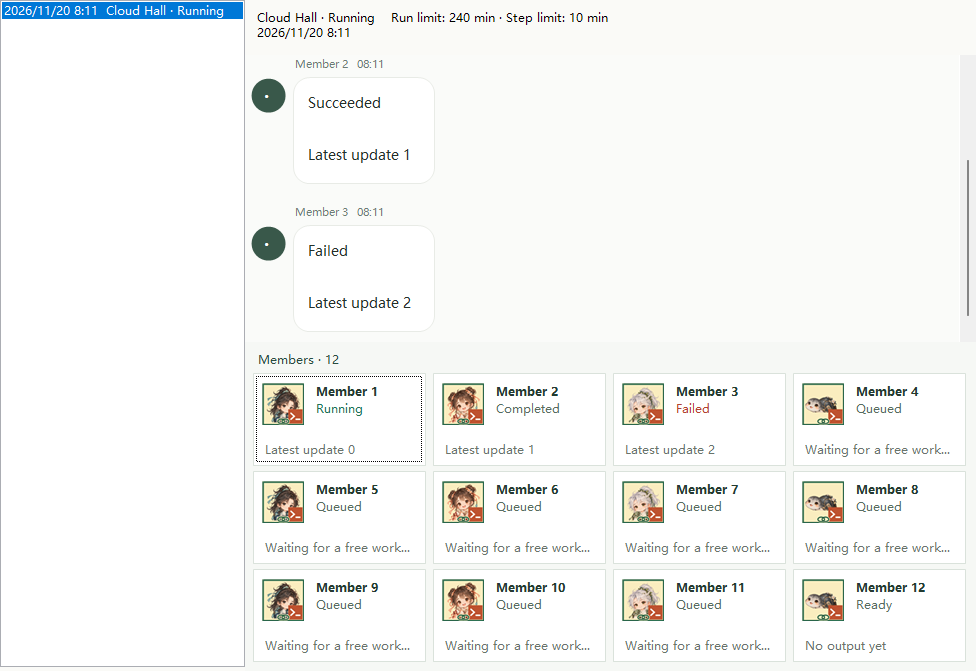
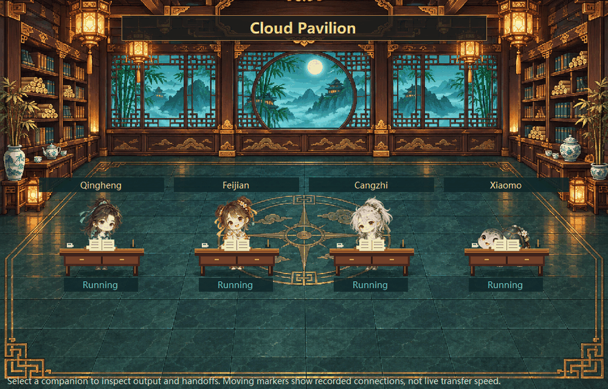

# Event planning and multi-agent workshop

[简体中文](WORKSHOP.zh-CN.md)

The workshop combines manually planned events, editable teams and a visible dependency workflow. Open it from the companion's context menu. Sample teams are not run automatically.

## Plan an event

Set a title, local date/time, recurrence and optional team name. Supported recurrence is `once`, `daily` or `weekly`. An event notifies you and offers a way to open its team; collaboration still requires confirmation.

Events do not wake the computer or execute while the app is closed. Overdue recurring events produce one catch-up notice and advance to a future occurrence. Windows notification settings can hide banners. This is a manual event table rather than a natural-language calendar integration.

## Define a team

Set **Worker slots** to 1–8 and edit each task's execution mode. Auto mode permits concurrent work in separate directories; tasks that share a member or an overlapping writable directory wait. Read-only review and isolated-output verification may run concurrently in the same project after their dependencies succeed. The development preset uses this split after implementation. These are agent instructions, not an OS sandbox.

## Member states and hall activity

The bottom of run records shows every member, including queued and unassigned members, with a portrait, state and latest update. Up to twelve cards adapt to the window; compact cards retain complete state labels and put longer details in tooltips. Click or keyboard-select a card to follow that member's most recent reply. New records retain a roster snapshot so editing a team does not rename old participants.

Working members alternate desk reading and short walks. New recorded transfers trigger a visit to the receiving member, who waits at their desk. Pending visits to the same recipient are grouped; no extra agent request is created. Hidden scenes discard their animation backlog, and reduced motion uses static work poses. Recorded transfers remain available independently of the illustration.

## Context-limit failures

Directory-discovery guidance starts with top-level and targeted searches, follows actual shell capabilities, and avoids broad scans of third-party dependency trees unless the task requires them. Upstream evidence and recovery excerpts share explicit size budgets. These instructions guide Claude; the app does not rewrite or intercept Claude's internal tool results.

When the CLI reports a failed result after partial text, the error is still shown. A context-limit error is saved as such and cannot become a successful task merely because the process exits with code zero. Automatic handoff uses a fresh context and a compact failure summary rather than replaying oversized tool output. The existing three-attempt limit still applies. A configured model's own context limit can still be reached; narrow the task or target directory and retry when needed.

The run view follows the member whose output changed most recently, including when a previously started member speaks again. Returning to the window brings its latest text into view. **Pause dispatch** lets current workers finish without starting queued steps. **Retry failed steps** preserves successful steps and retries only failed or blocked steps, up to three attempts.

These controls adapt the bounded execution and visible waiting-state principles discussed in [agent-autoloop](https://github.com/KKKKhazix/agent-autoloop/blob/main/docs/protocol.md). Agent-pal currently keeps its existing local task model; it does not embed that project's event-sourced kernel, external notification integrations or human-answer protocol.

Start with the four-companion consultation or development preset, choose a working directory and specify the shared goal, authorized scope and acceptance criteria. See [role presets](COMPANION-ROLES.md).

Each member has a unique ID, name, role, companion and directory. Each task has a unique ID, member ID, prompt and optional comma-separated dependency IDs. IDs are case-insensitive. A team supports up to 12 members and 24 tasks.

Use the add, edit and remove buttons above each table, then save the team. The tables show compact, wrapping summaries. Select a row and click Edit to view or change its full details. Renaming an ID updates its references in the draft. Reassign tasks or remove downstream dependencies before deleting a referenced row.

| Task | Member | Depends on | Example |
| --- | --- | --- | --- |
| plan | planner | — | Inspect the specified documents and propose a change |
| build | builder | plan | Implement the approved change in the test directory |
| review | reviewer | build | Inspect the result and report findings |

## Execution and handoffs

Confirm the listed directories and model usage before running. Each step starts its own configured local Claude session. Two worker slots are available by default, configurable from one to eight. Dependencies, execution mode and workspace access determine which ready steps can run together. Only one workshop workflow runs at a time.

Completed upstream output is summarized into the actual downstream request, with an 8,000-character total handoff budget. It is model-generated context, not new user authorization. Handoffs appear only after being submitted; animated links do not represent hidden reasoning or exact network throughput.

Set the run and per-step time limits independently. The defaults are 240 and 10 minutes. **0 means unlimited** for either field. Setting only the overall limit to 0 keeps the per-step limit active; set both to 0 for no time limit. A finite overall limit stops active steps and prevents queued steps from starting.

**Hand off failed tasks to another member** is enabled by default. A failed CLI run, a per-step timeout or an explicit `AGENT_PAL_RESULT: failed` final line passes the task to a different member. Selection favors matching task/role vocabulary and uses roster order as a tie-breaker. The replacement keeps the original task directory, execution mode, dependencies and authorization scope. It receives bounded prior output and instructions to inspect existing artifacts before continuing. Busy members and workspace conflicts still wait for a free slot.

Each task gets at most three total attempts, including manual retries. Prior members, timestamps, exit codes and output remain in the run record. Cancellation and an overall timeout never trigger a handoff. `AGENT_PAL_RESULT: needs-user` stops for missing authorization, credentials or a user decision. If no untried member is available, the task stays failed and dependent steps are blocked. Role instructions and CLI permissions remain in effect; takeover is not a guarantee of automatic recovery.

Run records show assignments, companion replies and handoffs as chat bubbles. Select a past run to read its saved messages. Closing the window lets the work continue. Stop cancels the CLI processes started by the run. Quitting the pet interrupts local collaboration, and the interrupted run remains in the history after restart.

The scheduler does not bypass tool permissions or provide a filesystem/network sandbox. It does not coordinate file locks with scheduled or manually launched Claude sessions. Separate directories can still access a shared external file. Use isolated worktrees/environments where required; inspect tests before running Bash.

## Hall and history

The hall uses the original transparent companion frames at proportional workstations, with desks, scrolls, tea and an illustrated background. Resize or maximize the window to reflow the scene. The Windows divider adjusts the hall/detail balance. Clicking a member shows its actual prompt, visible output and incoming/outgoing summaries.

Statuses distinguish idle, dependency wait, running, complete, failed and interrupted. The Windows hall keeps at most 24 recent animated cross-member links while detailed history retains the records. It refreshes changed content at most every 300 ms.

`scenes/sect-hall-v2.png` is loaded relative to the app. The Windows app has an embedded fallback. The installer verifies and deploys the scene; it is not dependent on the shell's current directory.

Configuration, events and recent runs are stored in `workshop.json`. Progress is saved periodically; output and history have bounds. Corrupt state disables the module with a notice rather than silently overwriting it. Do not publish these records with source code.

## Development checks

Shared model/scheduler: `SectWorkshop.cs`. Windows UI: `WorkshopForm.cs`, `SectHallControl.cs`, `PetForm.Workshop.cs`. Linux UI: `WorkshopWindow.cs` and its native hall.

Run `tests/workshop-test.ps1`, `tests/hall-layout-test.ps1` and `tests/hall-scene-install-test.ps1` on Windows. Linux CI uses isolated fake agents and actual X11 windows. Real CLI permission, proxy and target desktop acceptance remains separate.
