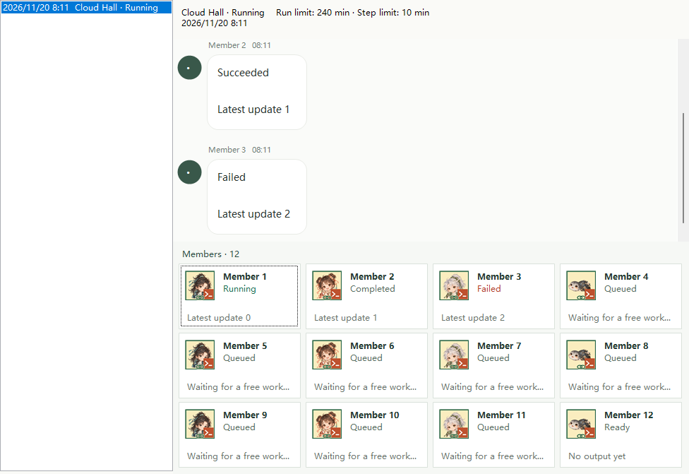
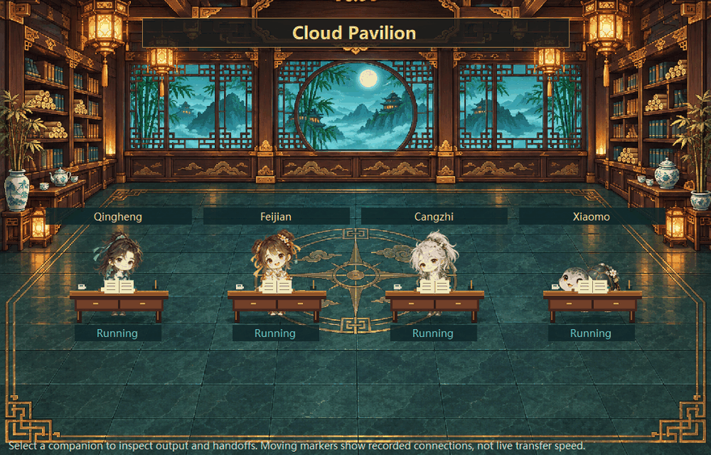

[English](WORKSHOP.md)

# 事件规划与Agent 协作（0.6 Preview）

这是可用的第一阶段升级，保留原有角色造型、骨骼步态、定时任务与热更新。所有入口均在伙伴右键菜单。不会自动发布 GitHub，也不会自动运行示例任务。

## 事件规划

右键“事件规划 / Agent 协作”→“事件规划”。填写标题、本地日期时间、重复类型与可选Agent 团队名称，保存。

- `once`：一次；`daily`：每日同一时间；`weekly`：每周同一天同一时间。
- 事件到点发送Windows托盘通知。点击通知打开工作台；关联Agent 团队可快速定位，但**仍需要点击确认执行协作**。
- 休眠/关机/程序退出时不执行，不唤醒电脑；下次运行补提醒一次，并将重复事件推进到未来，避免批量补发。
- Windows专注助手/关闭系统通知可能隐藏横幅，请自行确认系统通知设置。
- 取消事件可将“已完成”设为 True 或删除行，再保存；False 表示尚未完成。
- 这是手工规划事件表，不是自然语言自动拆日程，也未对接外部日历。复杂周期与自动执行仍可使用原有“Claude Code 定时任务”。

## 自定义Agent 团队和协作任务

**并发工位**可设 1–8。编辑任务时选择「自动」「只读，可并行」「仅写隔离输出，可并行」或「独占串行」。调度器先检查依赖，再检查成员与目录冲突；同目录的只读审查和隔离验证可以并行，修改同一目录或使用同一成员的任务互斥。新建研发预设中，实施完成后审查与隔离验证并行，汇总等二者完成。访问方式是给 Agent 的执行约定，不是操作系统沙箱。

运行记录跟随最近有输出变化的成员；切回窗口时定位最新内容，长回复内部也滚到最新一句。「暂停派发」让在跑的步骤收尾，剩余步骤等待；「重试失败步骤」保留已成功的步骤，只重跑失败和受阻步骤，最多三次尝试。运行页显示等待依赖、成员或工作目录的原因。

## 成员状态与工作区动作

执行记录底部用头像卡片列出全部成员，包含排队、失败、已交接和未分配任务的成员。十二位成员可自适应排列，较紧凑的卡片仍保留完整状态，完整任务与最新摘要可悬浮查看。点击卡片或使用方向键、Enter 选择后，会持续跟随该成员的最新回复。新记录保存成员快照，后续编辑Agent 团队不会改掉旧记录中的成员身份。

执行中的Agent会巡视工位、翻阅报告；新交接到来时，发送者沿过道走到接收者旁边，接收者等待，结束后返回。向同一接收者积压的演绎会合并，不新增模型调用，不改变任务的并行或依赖顺序。隐藏工作区后返回不重播旧动画；减少动态效果时使用静态工作姿态。

## 上下文超限

成员会先进行定向目录检查，按实际系统及 shell 选择工具，默认不递归展开大型第三方依赖树；上游摘要和失败接手有总长度预算。这些是给 Claude 的执行约定，程序不会截改 Claude 内部的工具结果。

CLI 在部分回复之后返回错误时，错误仍会显示；上下文超限会单独记录，不能因为进程退出码为 0 就误判成功。自动接手使用新上下文和精简失败摘要，不重放过长文件清单，仍遵守最多三次尝试。模型本身的限额仍可能触发，需要时收窄任务或目录后重试。

参考 [agent-autoloop 的协议设计](https://github.com/KKKKhazix/agent-autoloop/blob/main/docs/protocol.md)，本次借鉴有界执行、可解释等待与暂停恢复。完整的事件溯源内核、外部通知通道和人工问答回执协议尚未集成。

使用“成员定义”和“任务与依赖”上方的新增、编辑和删除按钮，再点击“保存Agent 团队”。列表仅显示自动换行的摘要；选中一行后点击编辑，即可在独立窗口查看和修改完整内容。改编号会更新草稿中对应的引用；删除被引用的行前，须先重分配任务或解除依赖。

0.6.7默认使用四 Agent职责预设。“审查 Agent 团队”用于先做只读研究，“研发 Agent 团队”用于已授权的实现与验证。创建前明确选择目录，创建后填写共同目标/授权范围/验收要求。原有Agent 团队不被自动改写。详情见[四 Agent能力与职责](COMPANION-ROLES.zh-CN.md)。

“Agent 团队”→新建Agent 团队：填写名称，设置成员编号、姓名、职责与工作目录。

例如：成员 `planner` 负责分析计划，`builder` 负责实施，`reviewer` 负责验证。

任务表每行是一项步骤：

| 任务编号 | 成员编号 | 依赖 | 工作内容示例 |
| --- | --- | --- | --- |
| plan | planner | 空 | 阅读指定文档，输出修改计划 |
| build | builder | plan | 按计划修改测试目录中的示例文件 |
| review | reviewer | build | 检查修改并报告结果，不额外修改文件 |

依赖使用任务编号，多个以逗号分隔。编号不区分大小写，必须唯一。成员姓名也须唯一。每个Agent 团队最多12位成员、24项任务。

保存后点击“确认并执行协作”，确认列出的工作目录与额度消耗。每个步骤调用独立的本机Claude CLI会话，职责写入任务上下文，不是创建Codex聊天，也不是调用Claude实验性的原生Agent Teams。无需新增API密钥，但需要本机CLI已授权。

- 默认两个并发工位，可设为 1–8；依赖、执行方式和目录访问规则共同决定哪些步骤可并行。同一时刻只执行一个Agent 团队工作流。
- 上游成功后，把其可见输出摘要写入下游实际提示词，总计最多8000字符。上游输出是模型生成内容，不代表新的用户授权。
- 不自动跳过CLI权限，不添加危险的自动批准参数。CLI拒绝工具权限时，可能失败或只能输出建议，不应视作已完成文件修改；请检查结果。
- 不隔离操作系统文件权限或网络；Claude能访问的范围由其CLI权限、目录规则与本机账户决定。并发目录检查不是沙箱，不解析junction/git worktree别名。不同目录仍可能访问同一外部文件；需要严格隔离时自行准备独立工作树/环境。
- 不与旧定时任务/你手动开启的CLI做跨进程互斥。不要让这些任务同时改同一文件。
- 整次时限和单轮时限分别设置，默认 240 和 10 分钟；任一项填 **0 表示该项不限时**。仅整次填 0 时，单轮仍有时限；两项均为 0 则都不限时。有限的整次时限到点后停止正在运行的步骤，不再派发等待步骤。
- 默认开启“失败时由其他成员接手”。进程失败、单轮超时，或模型最后一行明确返回 `AGENT_PAL_RESULT: failed`，会转交未尝试过的其他成员。优先匹配任务与职责中的关键词，同分按成员顺序选择；忙碌成员和目录冲突仍须等待。
- 接手保留原任务目录、执行方式、依赖和授权范围，携带有长度限制的失败输出，要求先检查已有产物再继续。每项任务总计最多尝试三次（含手动重试），各次成员、时间、退出码和输出均保留。无其他可接手成员时保留失败并阻断下游。
- 用户取消、整次超时不触发接手。模型返回 `AGENT_PAL_RESULT: needs-user` 时等待用户处理授权、凭据或决策，不通过换成员绕过权限。接手成员仍遵守自己的职责和 CLI 权限，不保证自动修复成功。
- 在“运行记录”中选中一次协作即可回看任务分派、Agent回复与交接内容。点击“停止本轮”可结束该次协作启动的 CLI 进程。
- 关闭工作台窗口不取消执行；退出伙伴会取消当前本地协作。不自动恢复中断任务，重启后显示interrupted。

## Agent 工作区

### 自适应窗口与详情区（0.6.8）

拖动窗口边缘或最大化，工作区按实际可用宽高重排工位。人物、桌子整体等比缩放，Agent 团队名和状态保持可见；不再每300ms把场景恢复到固定高度。上下分隔条可拖动调节工作区与详情的比例，之后缩放窗口仍保留该比例和正在查看的成员回复。常用四 Agent在默认及最小窗口内直接铺满，较多成员或较大的字体需要额外空间时才显示纵向滚动条，不横向滚动。

背景等比铺满，宽屏或较矮的工作区区域会裁去部分背景装饰；角色、工位、Agent 团队名和操作区独立布局，不随背景裁切。成员点击区域与当前布局同步；缩放或切换运行记录后仍可点击查看对应回复。

回归测试：`./tests/hall-layout-test.ps1`，包含不同宽高、成员数与字体尺度的几何检查，以及真实窗口反复缩放、最大化、详情分隔、隐藏标签页、点击和滚动检查；不调用模型。

### 背景部署与回退（0.6.7）

背景位于安装目录 `scenes/sect-hall-v2.png`。安装器会部署、验证并在更新时备份该目录；不是只解压到临时文件夹。程序按自身所在目录加载，不依赖PowerShell当前工作目录；外部文件缺失或无法解码时回退到程序内嵌的默认背景。若自行编译时遗漏两种来源，界面会提示资源缺失，不再静默显示纯色。

旧版缺图：先退出agent-pal，再安装完整0.6.7版本即可补齐。测试 `./tests/hall-scene-install-test.ps1` 会在隔离目录真实安装/覆盖安装，并从安装位置加载生产程序集、验证背景实际渲染；不会改动真实用户启动项、Claude配置或现有安装。

“Agent 工作区”显示Agent 团队牌匾、地砖、灯笼、成员工位和角色。待命、等待依赖、运行、完成、失败与中断各有状态标记，执行中的成员会播放工作动作。

工作区以国风像素插画为背景，角色使用与桌面伙伴相同的原始透明帧，按工位等比例缩放。成员表的“人物形象”列可选择青衡、绯笺、苍芷和小墨。每位成员有一张木质案桌、卷轴、笔墨和茶盏。成员较多时可滚动查看。

上游摘要成功提交给下游CLI后才创建传递记录，连接工位并显示流动光点。光点只表示这条**真实已记录的交接关系**，不是重复模型调用、精确数据传输速率或模型的内部思考。最多绘制最近24条跨成员连线，完整交接记录在成员详情中。

点击成员，下方显示它的实际提示词、可见回复与发出/收到的交接摘要；每300ms最多刷新一次，并仅在内容变化时替换。运行记录页可回看最近运行。协作还未启动时只显示工位待命，不伪造进度。

## 数据、安全与开发

配置、事件和最近5轮执行记录保存到应用状态目录的 `workshop.json`，约5秒保存运行进度。记录体积超过预算会提前删除最早历史；单步骤输出最多16000字符。内容可能含目录、任务、模型回复和文件信息，请勿随源码上传。文件损坏时禁用模块并提示，不静默清空覆盖原文件。

核心：`SectWorkshop.cs`（数据/调度）、`WorkshopForm.cs`（配置与记录）、`SectHallControl.cs`（像素工作区）、`PetForm.Workshop.cs`（生命周期与入口）。

离线回归：`./tests/workshop-test.ps1`。使用伪Agent和隔离目录验证调度、UTF-8、存储、形变透明度与窗口；不启动真实模型。真实CLI交互、额度/权限、企业代理及特定目录仍需你在本机验收。
